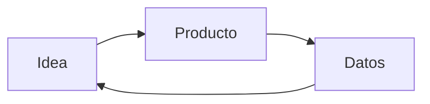

# Cómo usar este repo

## Para estudiar

1. **Leé el resumen** de la unidad (el `README.md` de su carpeta). Los diagramas son el "mapa" para ubicarte.
2. **Hacé las fichas** (`fichas.md`): respondé en voz alta antes de abrir la respuesta. Las que no te salen, anotalas y repetilas al día siguiente.
3. **Repaso de a dos:** una lee la pregunta, la otra responde. Cambien de rol cada cinco fichas.
4. **Antes del final:** repasá el [glosario](/glosario.md) completo y las preguntas de repaso al pie de cada resumen.

## Sumar una unidad nueva

Cuando el campus libere una unidad:

1. Abrí la carpeta de la unidad (por ejemplo `modulo-1/unidad-3/`) y reemplazá el `README.md` de esqueleto por el resumen. Usá como modelo el de [M1 · U1](/modulo-1/unidad-1/README.md): objetivos, mapa conceptual, una sección por tema, autores citados y preguntas de repaso.
2. Creá `fichas.md` en la misma carpeta, con el mismo formato de preguntas desplegables:

   ```html
   <details>
   <summary>¿Pregunta?</summary>

   Respuesta.

   </details>
   ```

3. Sumá la página de fichas al menú en [`_sidebar.md`](https://github.com/micaeladesign/diplomatura-product-management/blob/main/_sidebar.md) y sacale el ⏳ a la unidad.
4. Agregá los términos nuevos al [glosario](/glosario.md) y los libros nuevos a la [bibliografía](/bibliografia.md).
5. Actualizá la tabla de avance en el [inicio](/).

## Diagramas

Los diagramas están escritos en [Mermaid](https://mermaid.js.org/), que GitHub y el sitio dibujan solos. Un ejemplo:

````markdown

````

Para probar uno antes de guardarlo: [mermaid.live](https://mermaid.live/).

## Editar sin saber Git

En GitHub, abrí cualquier archivo `.md`, tocá el lápiz ✏️, editá y guardá con "Commit changes". El sitio se actualiza solo en uno o dos minutos.

## Ver el sitio en tu compu

No hace falta, pero si querés: desde la carpeta del repo, `npx docsify-cli serve .` y abrí `http://localhost:3000`.
