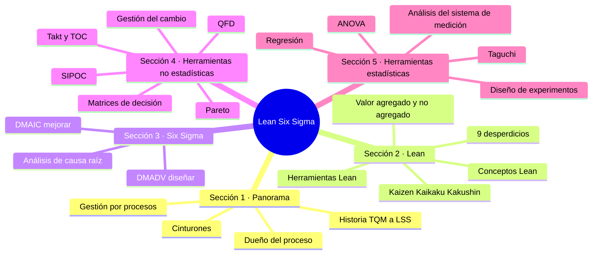

# Lean Six Sigma · *The Lean Six Sigma Black Belt Handbook*

> **Libro:** *The Lean Six Sigma Black Belt Handbook: Tools and Methods for Process Acceleration*, de Frank Voehl, H. James Harrington, Chuck Mignosa y Rich Charron (CRC Press / Productivity Press, 2014).
> **Qué es esta sección:** un resumen propio, en castellano, para estudiar el libro. Acompaña a los audios de NotebookLM; no los reemplaza ni reemplaza al libro.
> 👉 [Fichas de repaso](/lean-six-sigma/fichas.md) · [Glosario LSS](/lean-six-sigma/glosario.md) · [Puente con Product](/lean-six-sigma/puente-product.md)

## 🎧 Audio de introducción

Resumen en audio armado con NotebookLM (unos 18 minutos). Sirve como puerta de entrada a todo el libro; no sigue el orden de los capítulos.

<audio controls preload="none" style="width:100%" src="lean-six-sigma/audio/intro-lean-six-sigma.m4a"></audio>

Si el reproductor no aparece (por ejemplo, leyendo desde GitHub), [descargá o abrí el audio](https://github.com/micaeladesign/diplomatura-product-management/raw/main/lean-six-sigma/audio/intro-lean-six-sigma.m4a).

## Por qué este libro en una diplomatura de Product

Lean Six Sigma (LSS) nació en fábricas, pero sus ideas de fondo son las mismas que después adoptaron Lean Startup, Lean UX y los equipos ágiles: **mirar el proceso desde el cliente, sacar todo lo que no le agrega valor, medir antes de opinar y mejorar de a poco, siempre**. Leerlo ayuda a entender de dónde vienen herramientas que en la diplomatura aparecen sueltas (5 Porqués, Pareto, FODA, Kaizen, métricas).

## Lean, Six Sigma y Lean Six Sigma en una tabla

| | **Lean** | **Six Sigma** | **Lean Six Sigma** |
|---|---|---|---|
| Pregunta central | ¿Qué sobra en este proceso? | ¿Por qué este proceso es inconsistente? | Las dos |
| Enemigo | El **desperdicio** (*muda*) | La **variación** | Desperdicio y variación |
| Promete | **Velocidad** y flujo | **Calidad** casi perfecta (3,4 defectos por millón) | Velocidad con calidad |
| Estilo | Más cualitativo: observar, ordenar, simplificar | Más cuantitativo: datos y estadística | Usa estadística cuando hace falta, no siempre |
| Motor de mejora | **Kaizen** (mejora continua) | **DMAIC** (mejorar) y **DMADV** (diseñar) | Kaizen dentro de las fases de DMAIC/DMADV |
| Origen | Ford, Gilbreth y el Sistema de Producción Toyota | Motorola (1986), popularizado por GE | La fusión de ambos en los 2000 |

> **Idea fuerza del libro:** LSS no es una caja de herramientas sino una **forma de gestionar**. Las herramientas sin cambio cultural dan ahorros que duran poco.

## Mapa conceptual del libro

## Cómo está organizada la sección

| Página | Capítulos del libro | Qué hay |
|---|---|---|
| [Sección 1 · Panorama y procesos](/lean-six-sigma/seccion-1.md) | Cap. 1 y 2 | Qué es LSS, historia, cinturones, fases de un programa, gestión por procesos |
| [Sección 2 · El camino Lean](/lean-six-sigma/seccion-2.md) | Cap. 3, 4 y 5 | Los 9 desperdicios, conceptos y herramientas Lean, Kaizen, Kaikaku y Kakushin |
| [Sección 3 · DMAIC y DMADV](/lean-six-sigma/seccion-3.md) | Cap. 6 | Six Sigma, niveles sigma, las dos rutas y cómo se mezclan con Lean |
| [Herramientas clave](/lean-six-sigma/herramientas.md) | Cap. 7 a 10 | SIPOC, Ishikawa, 5 Porqués, Pareto, matrices, Takt, TOC, VSM, CTQ, QFD y las estadísticas explicadas simple |
| [Puente con Product](/lean-six-sigma/puente-product.md) | — | Cómo se conecta todo con Lean Startup, Lean UX, métricas y mejora continua |
| [Glosario LSS](/lean-six-sigma/glosario.md) | Apéndice A, resumido | Términos de Lean Six Sigma de la A a la Z |
| [Fichas de repaso](/lean-six-sigma/fichas.md) | Todo el libro | Preguntas con respuesta desplegable |

## Cómo estudiarlo con los audios

1. **Escuchá** el audio de NotebookLM de la sección.
2. **Leé** la página de la sección acá: los diagramas fijan lo que escuchaste.
3. **Hacé las fichas** de esa sección en voz alta.
4. Al final, leé el [puente con Product](/lean-six-sigma/puente-product.md): es lo que más vas a usar en la diplomatura.

> 💡 Las secciones 4 y 5 del libro son un manual de consulta (herramientas en orden alfabético). No hace falta estudiarlas de corrido: con la [página de herramientas](/lean-six-sigma/herramientas.md) alcanza para saber qué es cada una y cuándo usarla.

## Autores

| Autor | Quién es |
|---|---|
| **H. James Harrington** | Referente histórico de la calidad (muchos años en IBM, después Ernst & Young y su propia consultora), autor de decenas de libros sobre mejora de procesos. |
| **Frank Voehl** | Formador y certificador de cinturones Lean Six Sigma (Harrington Institute); coautor de los manuales Yellow y Green Belt de la misma serie. |
| **Chuck Mignosa** | Más de 25 años en IBM implementando sistemas de calidad; luego consultor en Six Sigma y Lean Manufacturing en Silicon Valley. |
| **Rich Charron** | Fundador de una consultora de Lean Manufacturing; Master Black Belt que coordinó más de 100 equipos y eventos Kaizen. Su mirada se nota sobre todo en la Sección 2 (el camino Lean). |
