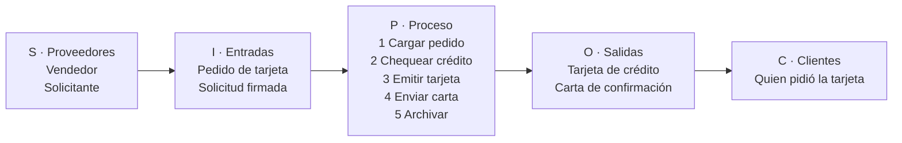
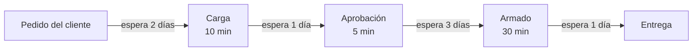
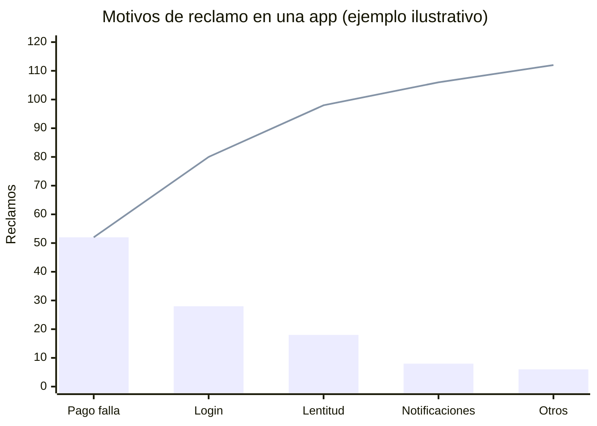
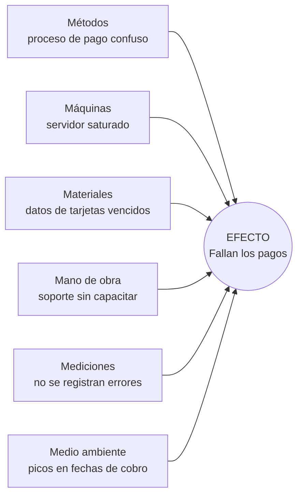
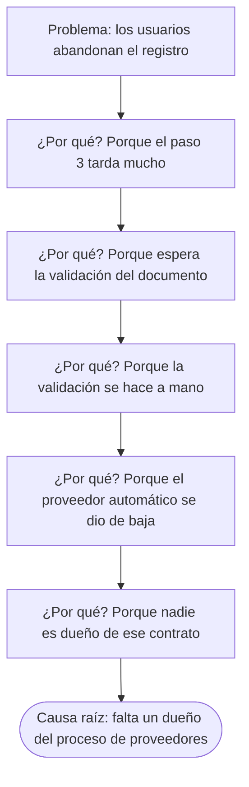
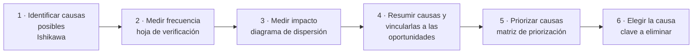
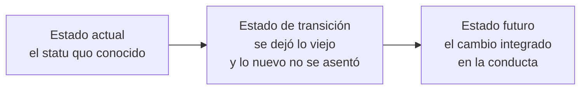

# LSS · Herramientas clave

> **Capítulos:** 7, 8 y 9 (herramientas no estadísticas del Black Belt, de la A a la Z) y 10 (herramientas estadísticas avanzadas). También retoma herramientas de nivel Green Belt que el libro da por sabidas (Apéndice C), como el diagrama de Ishikawa y los 5 Porqués.
> 👉 [Volver al inicio de LSS](/lean-six-sigma/README.md) · [Fichas de repaso](/lean-six-sigma/fichas.md)

En el libro estas secciones son un **manual de consulta**: cada herramienta trae definición, "solo los hechos" (*just the facts*), ejemplo y lecturas recomendadas. Acá van agrupadas según **para qué sirven** y en qué fase de [DMAIC](/lean-six-sigma/seccion-3.md) se usan más.

```mermaid
flowchart LR
  subgraph Entender["Entender el proceso · Definir"]
    SIPOC
    CTQ
    VSM[Mapa del flujo de valor]
  end
  subgraph Priorizar["Priorizar · Medir"]
    Pareto
    PM[Matriz de priorización]
  end
  subgraph Causas["Encontrar causas · Analizar"]
    ISH[Ishikawa]
    W5[5 Porqués]
    RCA[Causa raíz en 6 pasos]
    SC[Diagrama de dispersión]
  end
  subgraph Mejorar["Mejorar y decidir · Mejorar"]
    SM[Matriz de selección]
    Takt
    TOC
    FAST
  end
  subgraph Sostener["Sostener · Controlar"]
    OCM[Gestión del cambio]
    MED[Mediciones]
  end
  Entender --> Priorizar --> Causas --> Mejorar --> Sostener
```

---

## 1. Entender el proceso

### SIPOC

> "Entendé a tus proveedores y a tus clientes y vas a tener el 75% del camino al éxito." (frase de apertura del libro)

**Qué es:** un diagrama de alto nivel para identificar todos los elementos de un proceso **antes de empezar** un proyecto. Ayuda a acotar proyectos mal definidos.

**Siglas:** **S**uppliers (proveedores) · **I**nputs (entradas) · **P**rocess (proceso) · **O**utputs (salidas) · **C**ustomers (clientes).

*(Basado en el ejemplo del libro de un proceso de pedido de tarjeta de crédito.)*

**Cómo armarlo:**

1. Nombrar el proceso y marcar **dónde empieza y dónde termina**.
2. Listar los **4 a 7 pasos principales**, sin detalle.
3. Identificar las **salidas** y quiénes las reciben (**clientes**).
4. Identificar las **entradas** y quiénes las proveen (**proveedores**).
5. Revisar con el equipo y, si se puede, con clientes y proveedores.

**Preguntas que ayuda a responder:** ¿qué hace el proceso?, ¿cuáles son sus etapas?, ¿dónde empieza y termina?, ¿quién lo usa y quién lo paga?, ¿hay problemas obvios?

- Muestra **solo los pasos esenciales**, así que ayuda a enfocarse en lo que tiene que quedar en el proceso mejorado.
- Los procesos suelen crecer "a los parches"; el SIPOC es el primer paso para simplificarlos.
- El libro propone una variante extendida, **SIPOC-RM** (con requisitos y mediciones), y la desarrolla con el caso de una pizzería ("Mama Mia").

### CTQ · Crítico para la calidad

- Son las **características que el cliente considera indispensables**. Una forma de encontrarlas es un **gráfico de radar**: se puntúa de 1 a 10 la importancia de cada característica y se ve cuáles sobresalen (en el ejemplo del libro: "a tiempo" y "sin errores").
- Otra forma es un **árbol CTQ**: de una necesidad general del cliente ("quiero un buen servicio") se baja a motivos ("rápido", "correcto") y de ahí a requisitos medibles ("respuesta en menos de 24 horas").

### Mapa del flujo de valor (VSM)

1. Elegir el proceso a evaluar.
2. Dibujar el **estado actual**: pasos, tiempos, esperas, inventarios, traspasos.
3. Marcar dónde se corta el flujo continuo de información o producto.
4. Dibujar el **estado futuro** sin esos desperdicios.
5. Armar un plan para llegar.

*Ejemplo ilustrativo: 45 minutos de trabajo con valor agregado y 7 días de espera. Ese contraste es lo que un VSM hace visible.*

### QFD · Despliegue de la función de calidad

- "Función de calidad" no es el área de calidad: es **cualquier actividad** necesaria para lograr calidad, la haga quien la haga.
- Conecta **toda la empresa con la voz del cliente**: lo que el cliente quiere se traduce en características técnicas, después en partes, en procesos y en controles.
- Su matriz más conocida es la **Casa de la Calidad**: filas con los "qué" del cliente, columnas con los "cómo" técnicos, y un "techo" que muestra cómo se relacionan los "cómo" entre sí.

---

## 2. Priorizar

### Diagrama de Pareto

**Qué es:** un gráfico de barras ordenado de mayor a menor, con una línea de porcentaje acumulado. Separa **los pocos vitales de los muchos triviales**.

**El principio de Pareto (regla 80/20):** en muchos fenómenos, unas pocas causas explican la mayor parte del efecto.

*Las barras son reclamos por motivo; la línea es el acumulado. Con los dos primeros motivos ya se explica el 71% de los reclamos.*

**Cómo construirlo:**

1. Definir qué se va a comparar (problemas o causas) y el período.
2. Juntar los datos (por ejemplo, con una hoja de verificación).
3. Ordenar las categorías de mayor a menor. "Otros" va siempre al final.
4. Dibujar las barras y la línea del acumulado.
5. Atacar primero las barras de la izquierda.

**Clasificaciones típicas de los datos:** por tipo de problema, por causa, por ubicación, por momento, por cliente o por costo. Ojo: lo más frecuente no siempre es lo más caro; a veces conviene un Pareto por costo.

### Matriz de priorización

- Ordena problemas, causas o soluciones cuando hay **varios criterios** en juego.
- Cada criterio recibe un peso (más alto = más importante) y cada opción se puntúa contra cada criterio. Necesita **datos reales**, no solo opiniones.

---

## 3. Encontrar causas

### Diagrama de Ishikawa (causa y efecto o espina de pescado)

**Qué es:** un dibujo de **todas las causas posibles** de un problema, agrupadas en categorías. Lo creó Kaoru Ishikawa. El "pescado" tiene el problema en la cabeza y las causas en las espinas.

Las categorías clásicas son las **6M** (las 5M del libro más el entorno):

**Cómo armarlo:**

1. Escribir el **efecto** (el problema) bien concreto.
2. Dibujar las categorías principales.
3. Hacer una lluvia de ideas de causas en cada categoría. Para cada causa, preguntar "¿por qué pasa?" y sumar sub causas.
4. Marcar las causas más probables y **verificarlas con datos**: el diagrama muestra hipótesis, no certezas.

### 5 Porqués

**Qué es:** preguntar "¿por qué?" varias veces seguidas (alrededor de cinco) hasta llegar a la **causa raíz**, en lugar de quedarse en el síntoma.

**Tips:** responder con hechos, no con suposiciones; si hay varias respuestas posibles, abrir varias ramas; parar cuando la causa está bajo nuestro control y, si se corrige, el problema no vuelve. Encaja muy bien con el paso 4 del [Kaizen para resolver problemas](/lean-six-sigma/seccion-2.md).

### Análisis de causa raíz en 6 pasos

El libro reconoce que encontrar la causa raíz "es difícil y no hay una única forma que funcione siempre". Su idea de fondo: **no existen los problemas aleatorios**, solo combinaciones de variables que ocurren más o menos seguido. Encontrar la causa raíz es **aislar las variables clave**. Sabés que la encontraste cuando **podés hacer aparecer y desaparecer el problema a voluntad**.

### Diagrama de dispersión

- Grafica dos variables (una en cada eje) para ver **si están relacionadas** y cómo.
- Muestra **relación, no causalidad**: que dos cosas se muevan juntas no prueba que una cause la otra.
- La dirección y lo apretado de la nube de puntos indican el tipo y la fuerza de la relación.

### Diagrama de árbol

- Parte de un objetivo o problema y lo **baja en ramas** cada vez más detalladas.
- Sirve al principio (para analizar causas antes de juntar datos) y al final (para detallar un plan de implementación complejo).

---

## 4. Mejorar y decidir

### Matriz de selección (o de decisión)

1. Identificar las alternativas.
2. Acordar los criterios de decisión.
3. Darle un **peso** a cada criterio.
4. Definir una escala (por ejemplo, 5 = alto, 3 = medio, 1 = bajo).
5. Puntuar cada alternativa en cada criterio y multiplicar por el peso.
6. Sumar y comparar.

| Criterio | Peso | Opción A | Opción B | Opción C |
|---|---|---|---|---|
| Impacto en el cliente | 3 | 5 × 3 = 15 | 3 × 3 = 9 | 3 × 3 = 9 |
| Facilidad de implementación | 1 | 1 × 1 = 1 | 5 × 1 = 5 | 3 × 1 = 3 |
| Riesgo bajo | 2 | 3 × 2 = 6 | 3 × 2 = 6 | 5 × 2 = 10 |
| **Total** | | **22** | **20** | **22** |

*Ejemplo propio. Un empate como el de A y C es una buena señal para discutir los pesos en equipo.*

Las **matrices en L** comparan dos listas (opciones contra criterios); las **matrices en T** comparan dos listas contra una tercera.

### Takt time

> "Cuando las personas pierden el equilibrio, se caen. Cuando un proceso pierde el equilibrio, falla."

**Takt** significa "compás" en alemán: es el **ritmo al que hay que producir para seguir la demanda del cliente**.

> **Takt time = tiempo neto disponible ÷ demanda del cliente**

El tiempo neto disponible **descuenta** almuerzos, pausas, reuniones y mantenimiento programado.

**Ejemplo del libro, paso a paso:**

- 2 turnos de 8 horas = 16 horas. Cada turno pierde 1 hora de almuerzo y 2 pausas: quedan **13 horas** productivas por día.
- Demanda: 600 unidades por mes ÷ 21 días hábiles ≈ **29 unidades por día**.
- Takt = 13 horas ÷ 29 unidades ≈ **0,45 horas por unidad** (unos 27 minutos).

**Por qué importa:** el proceso va al ritmo de su paso **más lento**. Si los pasos tardan 10, 13, 12 y 17 minutos, el último frena todo y se acumula trabajo en proceso (WIP). La idea es **rebalancear** para que cada paso quede lo más cerca posible del takt, sin pasarse.

### Teoría de las restricciones (TOC)

> "Siempre hay un factor limitante. Solo hay que encontrarlo y eliminarlo."

- Creada por **Eliyahu Goldratt** (1984, popularizada con la novela *La meta*).
- Todo sistema está limitado por **muy pocas restricciones**, y siempre hay al menos una.
- Restricciones **internas** (equipos, personas mal capacitadas, procesos) o **externas** (por ejemplo, producir más de lo que el mercado demanda).
- Aplicaciones: en operaciones, "tirar" (*pull*) en lugar de empujar; en finanzas, mirar el efecto de cada paso en el *throughput* total; en proyectos, gestionar la **cadena crítica**.

### FAST · Técnica de solución de acción rápida

- Una reunión de **1 o 2 días** enfocada en **un solo proceso** para definir mejoras a implementar en los siguientes **90 días**. Antes de que termine la reunión, la dirección **aprueba o rechaza** cada propuesta.
- Nació en IBM en los 80; GE la llamó *Work-Out*, Ford *RAPID*.
- Suele lograr entre 5% y 15% de mejora en costo, tiempo de ciclo y errores en 3 meses.
- Idea clave: **empezar con victorias rápidas** ("la fruta al alcance de la mano") para ganar el apoyo de la dirección.

### Otras herramientas del manual

| Herramienta | En una línea |
|---|---|
| **Benchmarking** | Compararse con los mejores (dentro o fuera de la empresa) para traer ideas nuevas. Xerox lo popularizó en los 80. Puede ser interno, externo o combinado |
| **Eliminación de burocracia** | Detectar y sacar aprobaciones, papeles y pasos que solo existen "porque sí". Puede encararse por proceso o por incidente |
| **Análisis y reducción del tiempo de ciclo** | Medir cuánto tarda cada paso y atacar esperas y pasos innecesarios. Según el libro, es una de las seis mejores prácticas mundiales |
| **Resolución de conflictos** | Buscar una solución en la que ganen ambas partes, empezando por definir el problema desde los dos lados |
| **Just-in-time** | Señales (tarjetas o visuales) que indican cuándo hacer la siguiente pieza |
| **Gestión de proyectos** | Equilibrar alcance, tiempo, costo y calidad. El libro resume las áreas de conocimiento del PMBOK |
| **Gestión de la confiabilidad** | "La calidad hace la primera venta; la **confiabilidad** hace que el cliente vuelva". Un sistema en 8 fases, desde definir requisitos de confiabilidad hasta acciones correctivas |
| **FODA (SWOT)** | Fortalezas, Oportunidades, Debilidades y Amenazas, partiendo de un objetivo concreto. Parte de la planificación estratégica |
| **Mediciones** | Las buenas mediciones producen **conocimiento accionable**: indican qué hacer. Herramientas: hojas de verificación, histogramas, cartas de control, capacidad de proceso |

---

## 5. Sostener el cambio

### Gestión del cambio organizacional (OCM)

> Según Gartner, citado en el libro, hasta el **60%** de las iniciativas fracasan por no gestionar su impacto en las personas.

**Las 4 C:** cuando un cambio se vuelve personal, la gente pierde:

- **Comodidad** (*comfort*): se rompe su rutina.
- **Confianza** (*confidence*): duda de poder cumplir en el estado futuro.
- **Competencia** (*competence*): ya no es quien más sabe de su trabajo.
- **Control**: otro decide qué y cómo va a hacer.

**Los estados del cambio:**

**Las 7 fases de OCM:**

1. Definir el **dolor** del estado actual.
2. Construir una **visión clara** del estado futuro.
3. Definir los **roles** del cambio (patrocinador, agente de cambio, destinatarios, promotores).
4. Mapear esos roles en la organización.
5. Definir **cuánto cambio** se necesita.
6. Armar el **plan** de gestión del cambio.
7. Implementar el plan.

No todo cambio necesita OCM: se usa en cambios **críticos o grandes**, o cuando hay alto riesgo de que los factores humanos hagan fracasar la implementación.

---

## 6. Herramientas estadísticas (Capítulo 10), explicadas simple

No hace falta saber calcularlas para la diplomatura. Sí conviene saber **qué pregunta responde cada una**.

| Herramienta | Qué pregunta responde |
|---|---|
| **Población y muestra** | ¿Qué puedo concluir de todos los casos mirando solo una parte? |
| **Intervalos de confianza** | ¿Entre qué valores está, probablemente, el valor real? |
| **Diagrama de caja** (*box plot*) | ¿Cómo se distribuyen los datos? Mediana, cuartiles y valores atípicos de un vistazo. Sirve para comparar grupos |
| **ANOVA** (de una y de dos vías) | ¿Las diferencias entre los promedios de tres o más grupos son reales o casualidad? |
| **Regresión y mínimos cuadrados** | ¿Cómo cambia un resultado (Y) cuando cambian sus causas (X)? |
| **Diseño de experimentos** (DoE) | ¿Cómo pruebo varios factores a la vez y obtengo la mayor información con el menor costo? |
| **Análisis del sistema de medición** (MSA) | ¿Puedo confiar en mis datos? "Si entra basura, sale basura" |
| **Gráficos multivari** | ¿Cuál de varias variables es la que más afecta el resultado? |
| **Pruebas no paramétricas** | ¿Cómo comparo grupos cuando los datos no siguen una distribución normal? |
| **Transformación de datos** | ¿Cómo llevo datos "raros" a una forma en la que pueda aplicar las pruebas habituales? |
| **Rendimiento acumulado** (*rolled-throughput yield*) | ¿Qué porcentaje de unidades sale bien **en todos los pasos** sin retrabajo? |
| **Método Taguchi** | ¿Cuánto cuesta estar lejos del valor ideal, aunque estemos dentro de la especificación? |
| **Validación** | ¿El cambio que hicimos logró lo que prometía? |

**Dos ideas de este capítulo que vale la pena llevarse:**

- **Y = f(X):** en Six Sigma se **observa** el resultado (Y) pero se **trabaja** sobre las causas (X). Mejorar el resultado sin tocar las causas no se sostiene.
- **Función de pérdida de Taguchi:** la mirada tradicional dice "si está dentro de la especificación, está bien". Taguchi dice que **cualquier desvío del valor objetivo genera una pérdida**, que crece cuanto más te alejás. La calidad ideal es dar en el blanco, no solo "aprobar".

**Rendimiento acumulado, con números:** si un proceso tiene 3 pasos y cada uno sale bien el 95% de las veces, el rendimiento total es 0,95 × 0,95 × 0,95 ≈ **86%**. Por eso los procesos largos con muchos pasos "casi buenos" decepcionan.
