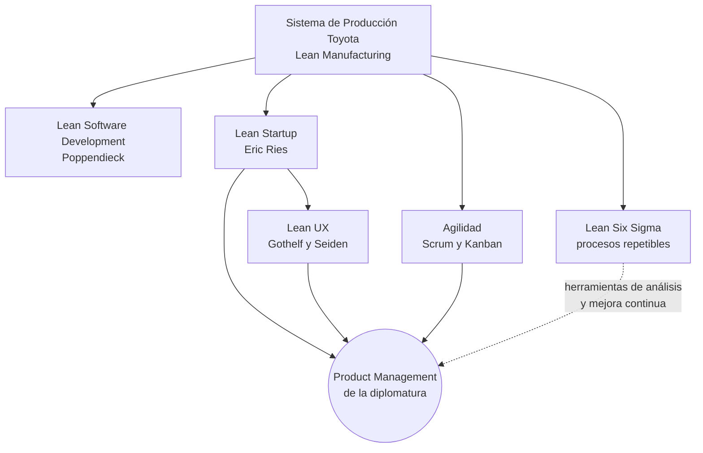
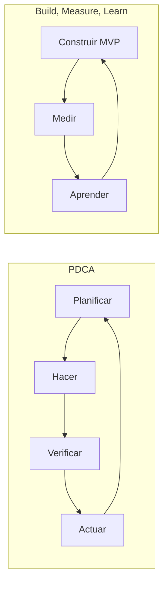

# Puente: Lean Six Sigma ↔ Product Management

> Esta página no resume el libro: conecta sus ideas con lo que vemos en la diplomatura. Es probablemente la más útil para los finales y los trabajos prácticos.
> 👉 [Volver al inicio de LSS](/lean-six-sigma/README.md) · [Fichas de repaso](/lean-six-sigma/fichas.md)

## La idea de fondo

Lean Six Sigma nació para **procesos repetibles** (fabricar, facturar, atender reclamos): ahí ya se sabe qué hay que hacer y el desafío es hacerlo rápido y sin errores. El Product Management trabaja con **incertidumbre**: todavía no sabemos qué hay que construir. Por eso el mundo de producto tomó el **espíritu** de Lean (valor para el cliente, aprendizaje rápido, eliminar desperdicio) más que sus herramientas al pie de la letra.

| | Lean Six Sigma | Lean Startup / Lean UX |
|---|---|---|
| ¿Qué es incierto? | Poco: el proceso existe y se sabe qué debe producir | Casi todo: el problema, el cliente, la solución |
| Unidad de progreso | Menos defectos, menos desperdicio, menos tiempo de ciclo | **Aprendizaje validado** |
| Ciclo | PDCA y DMAIC | **Construir, Medir, Aprender** |
| Experimentos | Diseño de experimentos (DoE) con control estadístico | MVP, A/B testing, Mago de Oz, *concierge* |
| Mayor desperdicio | Sobreproducción | **Construir algo que nadie quiere** |
| Cliente | Define la calidad con sus requisitos | Cocrea el valor y valida las hipótesis |

> **Idea fuerza:** Lean Startup es, en buena medida, aplicar el pensamiento Lean a la pregunta "¿qué deberíamos construir?". Ries lo plantea con una pregunta: ¿de qué sirve construir algo a tiempo, en presupuesto y con calidad, si nadie lo quiere? Es la frase de Drucker que abre el Capítulo 3 del libro, llevada a producto.

---

## 1. Ciclos de mejora: PDCA, DMAIC y Build-Measure-Learn

Los tres son primos. Todos son el **método científico** aplicado al trabajo.

| PDCA | DMAIC | Build, Measure, Learn | Lean UX Canvas |
|---|---|---|---|
| Planificar | Definir · Medir · Analizar | Ideas e hipótesis | Problema de negocio, usuarios, resultados, hipótesis |
| Hacer | Mejorar | **Construir** el MVP | El experimento más chico posible |
| Verificar | Mejorar (validar) | **Medir** | ¿Qué aprendimos? |
| Actuar | Controlar | **Aprender**: pivotear o perseverar | Ajustar e iterar |

- Ver [Clase 11/11: Build, Measure, Learn](/modulo-1/unidad-1/clase-11-11.md) y el [Lean UX Canvas en M1·U2](/modulo-1/unidad-2/README.md).
- **Diferencia clave:** DMAIC busca **estabilizar** un proceso conocido; Build, Measure, Learn busca **descubrir** lo que todavía no sabemos. En producto, el "Control" de DMAIC equivale a convertir lo aprendido en estándar (diseño, código, procesos del equipo) antes del próximo ciclo.
- **DMADV** (diseñar algo nuevo desde la voz del cliente) se parece más al trabajo de **discovery** que DMAIC.

## 2. Los 9 desperdicios en un equipo de producto

Mary y Tom Poppendieck (*Lean Software Development*, en la [bibliografía](/bibliografia.md)) tradujeron los desperdicios Lean al software. Combinando eso con el libro:

| Desperdicio LSS | En producto digital | Qué hacer |
|---|---|---|
| Sobreproducción | Features que nadie usa; **Feature Factory** | Validar antes de construir; medir *outcomes*, no *output* |
| Inventario | Backlog infinito, trabajo a medio hacer, código sin desplegar | Limitar el trabajo en curso (WIP), *releases* chicos y frecuentes |
| Defectos | Bugs, incidentes, requisitos mal entendidos | Calidad en la fuente: tests automatizados, criterios de aceptación claros |
| Procesamiento extra | Documentos que nadie lee, aprobaciones de más, pulir de más | Cuestionar cada paso del flujo: ¿el usuario lo pagaría? |
| Espera | Esperar revisiones, decisiones, otro equipo, un ambiente | Equipos autónomos, menos dependencias |
| Movimiento | Cambiar de contexto entre muchos proyectos y herramientas | Foco: menos cosas en paralelo |
| Transporte | Traspasos entre negocio, diseño, desarrollo y QA | Equipos multidisciplinarios desde el inicio |
| Talento no aprovechado | Equipo que solo "ejecuta tickets" | Equipos empoderados que participan del discovery |
| Comportamiento | Culpar, ocultar información, "siempre se hizo así" | Cultura de aprendizaje y seguridad psicológica (M3·U3) |

Esto conecta con los **anti patrones** de [M1·U1](/modulo-1/unidad-1/README.md): la *Feature Factory* es sobreproducción, y el *Full Quality* (máxima calidad en todo) es procesamiento extra.

## 3. Valor: desde el cliente, siempre

- LSS define calidad como **cumplir los requisitos del cliente** y valor como **lo que el cliente está dispuesto a pagar**.
- En la diplomatura, el valor es una **percepción subjetiva** y se **cocrea** con el usuario ([M1·U1](/modulo-1/unidad-1/README.md)). Es una mirada más amplia, pero el punto de partida es el mismo: **el cliente decide qué vale**.
- Herramientas puente:
  - **Voz del cliente y CTQ** ↔ **entrevistas, Empathy Map y propuesta de valor** ([M1·U2](/modulo-1/unidad-2/README.md)).
  - **QFD** (de lo que el cliente quiere a lo que construimos) ↔ **historias de usuario y Story Mapping** (M1·U4).
  - **Modelo de Kano** (es una herramienta Green Belt según el Apéndice C del libro) ↔ priorización en **M2·U2**.

## 4. Métricas: medir para decidir

| Idea LSS | Equivalente en producto |
|---|---|
| **Y = f(X)**: se observa el resultado, se trabaja sobre las causas | **Indicadores rezagados** (ingresos, churn) vs. **adelantados** (activación, uso semanal), M3·U2. La North Star y sus métricas de input |
| **CTQ**: lo que el cliente considera crítico | Métricas de experiencia: **HEART** (Google), NPS |
| **Línea de base** en la fase Medir | Medir antes de lanzar un cambio para poder comparar (A/B testing) |
| **Análisis del sistema de medición**: ¿confío en mis datos? | Calidad de los datos de analítica: eventos bien definidos, sin duplicados |
| **Cartas de control**: distinguir variación normal de una señal real | No reaccionar a cada subida o bajada diaria de una métrica |
| **Rendimiento acumulado**: cada paso multiplica la pérdida | **Embudo de conversión** y **AARRR**: si cada paso convierte 70%, cuatro pasos dejan solo el 24% |
| **Takt time**: el ritmo de la demanda | Pensar la capacidad del equipo según la demanda real, no según el pronóstico |
| "Las buenas mediciones producen conocimiento **accionable**" | Evitar **métricas de vanidad** (Ries): medir lo que cambia decisiones |

## 5. Herramientas que vas a reencontrar en la diplomatura

| Herramienta LSS | Dónde aparece en la diplomatura |
|---|---|
| **5 Porqués** | Técnica de entrevista para llegar a la causa raíz ([M1·U2](/modulo-1/unidad-2/README.md)) |
| **Pareto (80/20)** | Priorización de funcionalidades y problemas (M2·U2) |
| **FODA (SWOT)** | Estrategia de producto y análisis competitivo (M3·U2) |
| **Matrices de priorización y selección** | Priorización del backlog: MoSCoW, WSJF (M2·U2, M3·U1) |
| **Mapa del flujo de valor** | **Flow Framework** y métricas de flujo (M1·U4); **User Journey** como mapa del flujo de valor visto por el usuario (M2·U1) |
| **Kanban** | Tableros ágiles y límite de trabajo en curso (M2·U3) |
| **SIPOC** | Entender un proceso antes de digitalizarlo o automatizarlo; ver quién es cliente y quién proveedor de un servicio interno |
| **Ishikawa** | Postmortems de incidentes y análisis de por qué cae una métrica |
| **Benchmarking** | Análisis competitivo (M3·U2) |
| **Diseño de experimentos** | A/B testing y experimentos multivariados (M2·U2) |
| **Gestión del cambio (OCM)** | **ADKAR** y cultura (M3·U3); adopción de OKRs como cambio cultural (M3·U4) |

## 6. Mejora continua y cultura

- **Kaizen** ↔ **retrospectivas** de Scrum: el equipo revisa cómo trabajó y elige una mejora concreta para el próximo ciclo. Las tres leyes de "Kaizen y vos" (escribir la idea, implementarla, compartirla) son una buena retro personal.
- **Gemba** ("ir al lugar real") ↔ **observar a los usuarios** en su contexto, en lugar de suponer desde la oficina. Es la base del user research.
- **El paso siguiente es tu cliente** ↔ pensar en clientes **internos** de un producto de plataforma o de herramientas internas.
- **Organización tradicional vs. Lean** ↔ **Sense and Respond** y **Lean Enterprise** (en la [bibliografía](/bibliografia.md)): pasar de planificar y controlar a escuchar y responder.
- **El desperdicio de comportamiento** ↔ todo M3·U3: si la cultura castiga el error, nadie experimenta, y sin experimentos no hay Lean Startup.
- **Sostener lo ganado** (fase V de un programa LSS) ↔ un producto en madurez tiene que cuidar la **retención** ([ciclo de vida en M1·U1](/modulo-1/unidad-1/README.md)).

## 7. Dónde no conviene copiar Lean Six Sigma tal cual

Para pensar críticamente (y lucirse en un final):

- **Reducir la variación no siempre es bueno en producto.** En un proceso de facturación queremos que todo salga igual; en discovery **necesitamos variación**: probar ideas distintas, aceptar que muchas fallen.
- **La estadística pesada puede ser lenta.** Un DoE completo tiene sentido con mucho volumen de datos; muchas veces un MVP o cinco entrevistas enseñan más, más rápido.
- **"Calidad = cumplir requisitos" asume que los requisitos son correctos.** En producto, el riesgo principal es que el requisito esté mal. Por eso el foco pasa a validar el problema (Problem-Solution Fit, PMF).
- **El ahorro no es la meta.** El propio libro dice que el éxito de LSS no se mide en dólares ahorrados sino en cambio cultural; en producto, se mide en **resultados para usuarios y negocio** (*outcomes*).

> **Para cerrar:** LSS te da un **vocabulario y un método** para hablar de desperdicio, causas y mejora con datos. Lean Startup y Lean UX te dan la forma de usarlo cuando todavía no sabés qué construir. Un buen PM usa las dos cajas según el problema.

---

## Preguntas para pensar (sin respuesta única)

1. Elegí un producto que uses todos los días. ¿Qué desperdicios Lean le ves desde el lado del usuario?
2. ¿En qué se parecen y en qué se diferencian DMAIC y Build, Measure, Learn?
3. ¿Cuándo usarías Six Sigma dentro de un equipo de producto? Pensá en procesos de soporte, pagos o logística.
4. ¿Por qué la sobreproducción es el desperdicio más peligroso para un PM?
5. Armá un Ishikawa para "cayó la retención del mes".
