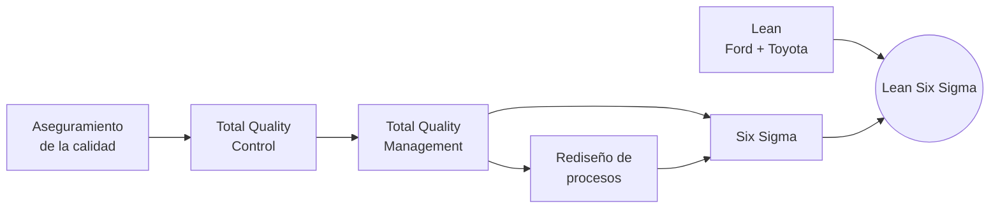
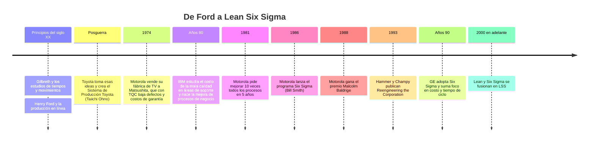
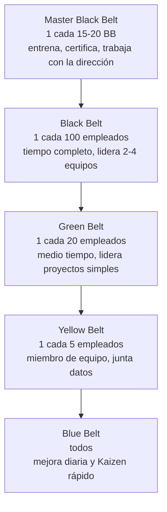
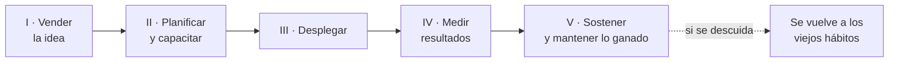
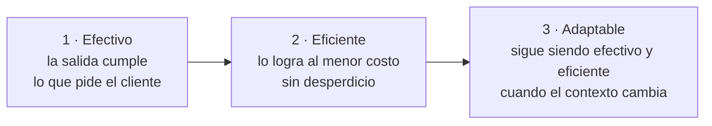
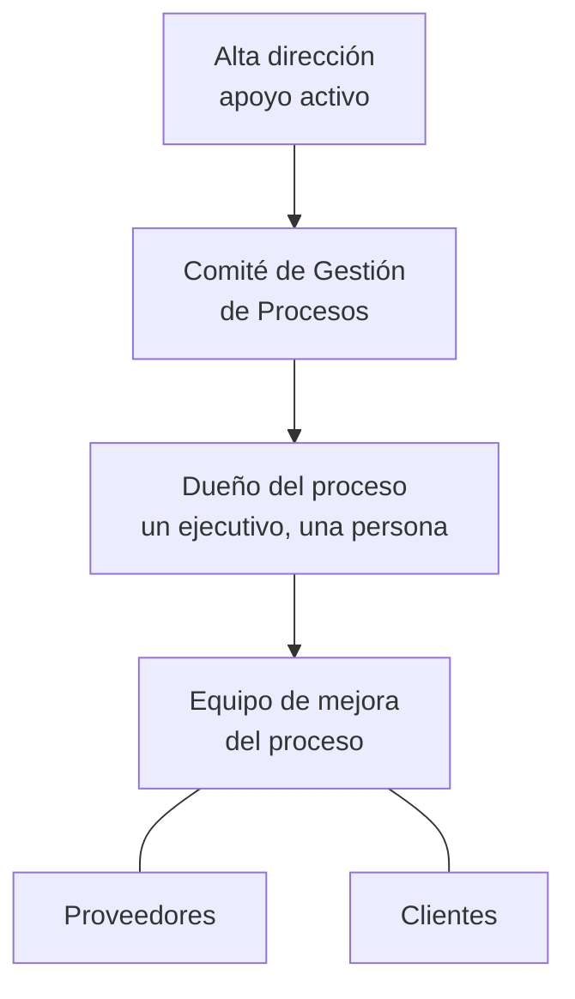

# LSS · Sección 1 — Panorama y gestión por procesos

> **Capítulos:** 1 (Introducción a la metodología Lean Six Sigma) y 2 (Mejora de procesos y Lean Six Sigma).
> 👉 [Volver al inicio de LSS](/lean-six-sigma/README.md) · [Fichas de repaso](/lean-six-sigma/fichas.md)

## Qué te tiene que quedar

- Qué es Lean, qué es Six Sigma y qué agrega juntarlos.
- De dónde viene cada uno (spoiler: Lean es más viejo).
- Quién hace qué en un programa LSS: los **cinturones**.
- Por qué el libro insiste en gestionar **procesos** y no departamentos.

---

## Capítulo 1 · Introducción a Lean Six Sigma

### Tres definiciones operativas

- **Lean:** filosofía operativa para **identificar y eliminar todo desperdicio**. Trabaja hacia atrás desde lo que el cliente considera calidad: flujo en lugar de lotes, *pull* en lugar de *push*, cero esperas, cero inventario de más.
- **Six Sigma:** estrategia de gestión para **reducir la variación** y las causas de defectos, con fuerte uso de estadística. Arma una estructura de especialistas y trabaja con dos rutas: **DMAIC** y **DMADV** (ver [Sección 3](/lean-six-sigma/seccion-3.md)).
- **Lean Six Sigma:** filosofía de toda la organización que combina ambas para eliminar **nueve tipos de desperdicio** y llegar a **3,4 defectos por millón de oportunidades** (DPMO).

> **Idea fuerza:** Lean = **velocidad** (sacar lo que sobra). Six Sigma = **calidad** (que salga siempre igual y bien). Hacen falta las dos para competir.

### Sobre hombros de gigantes

El libro arranca con la metáfora de "pararse sobre los hombros de gigantes": LSS no es un invento nuevo sino la evolución de lo anterior. Cada enfoque amplió al previo:

Según una encuesta de los autores, más del 80% de lo que usa Six Sigma ya existía en TQM. Ponerle nombres japoneses (*muda*, *Kaizen*) a veces sirve solo para que la dirección lo vuelva a escuchar sin pensar "esto ya lo probamos".

### ¿Qué vino primero, Lean o Six Sigma?

- **Lean vino primero.** Gilbreth creía que había "una mejor manera" de hacer cada tarea; Ford armó la producción Lean; **Toyota** la perfeccionó.
- **Six Sigma** nace en **Motorola** como respuesta a perder mercado frente a los japoneses. Su meta: que todo proceso tenga como máximo 3,4 errores por millón de oportunidades.
- **GE** se dio cuenta de que reducir variación no alcanzaba: las grandes ganancias venían de **simplificar procesos y bajar costo y tiempo de ciclo**. Así Six Sigma sumó herramientas Lean y apareció DMADV.
- El libro cierra con una advertencia: mezclar Lean y Six Sigma "a la fuerza", sin entender la madurez del proceso, da resultados pobres.

### Cultura antes que herramientas

- El error más común es tratar LSS como un **conjunto de herramientas** o un proyecto con fecha de fin. Se resuelve el problema, todos vuelven a lo de siempre y el problema "se despierta" de nuevo.
- Quien hace exitoso a LSS no es el Black Belt: es el **ejecutivo que no tolera el desperdicio** y que tiene la excelencia como estándar diario, no como meta lejana.
- El éxito de un Black Belt **no se mide en dólares ahorrados** (eso es temporal) sino en un **cambio permanente de cultura**.

### Los cinturones

| Cinturón | Rol | Dato para recordar |
|---|---|---|
| **Master Black Belt** | Corazón del sistema: forma y certifica, aprueba proyectos, empuja el cambio cultural con la dirección | Al principio suele ser un consultor externo durante 6 a 12 meses |
| **Black Belt** | "Caballo de batalla": especialista que resuelve problemas complejos, no un coach | Se espera que genere al menos US$1 millón de ahorro por año y unos 8 proyectos anuales. El rol dura unos 2 años |
| **Green Belt** | Profesional que conoce bien el área; lidera o integra equipos | Hasta 50% de su tiempo en el proyecto, así que hay que liberarle carga |
| **Yellow Belt** | Integrante de equipo; experto del área que aporta datos | 2 o 3 días de formación |
| **Blue Belt** | Toda la fuerza laboral | Sostiene la cultura cuando los grandes problemas ya se resolvieron: sugerencias, análisis del área, "Kaizen rápido y fácil" |

- Un Black Belt reparte su tiempo así: 35% liderar proyectos, 20% ayudar a Green Belts, 20% enseñar, 15% análisis, 10% definir proyectos nuevos.
- Necesita seis habilidades: gestión de proyectos, liderazgo, pensamiento analítico, enseñanza a adultos, **gestión del cambio** y estadística. Elegirlo solo por lo analítico es "un error".
- **Ser Black Belt es un escalón, no una carrera:** en 1 a 3 años los grandes problemas deberían estar resueltos y la organización ya no necesita BBs de tiempo completo, pero sí su conocimiento.

### Las cinco fases de un programa LSS

La **fase V** es la más importante y la que menos organizaciones completan. El libro cuenta el caso de un cliente que, dos años después, tenía otra vez las bandejas llenas de papeles y la planta sucia: sin foco continuo en el desperdicio, todo vuelve atrás.

> **Cita para recordar (Harrington):** "Lean Six Sigma es un compromiso de por vida. Si no estás listo, no gastes la plata de la organización intentándolo".

---

## Capítulo 2 · Mejora de procesos y LSS

### Por qué mirar procesos

El libro cuenta el caso de una empresa que entre 1978 y 1994 triplicó productos y canales: el tiempo productivo de sus vendedores cayó del 40% al **5%**, tragado por papeleo y procedimientos que nadie había rediseñado. Cada área cumplía sus objetivos sin mirar cómo su trabajo afectaba al resto. La respuesta fue la **mejora de procesos** (*process improvement*, PI): gestionar el negocio por **procesos**, no por organigrama.

### Definiciones básicas

| Término | Definición del libro (resumida) |
|---|---|
| **Cliente** | Cualquiera que use la salida de un proceso. La mayoría de los clientes de un proceso son **internos**: trabajan en la misma empresa. |
| **Requisitos** | Las necesidades y expectativas del cliente que el producto o servicio tiene que satisfacer. |
| **Calidad** | **Cumplir los requisitos del cliente.** |
| **Proceso de negocio** | Personas, equipos, energía, procedimientos y materiales organizados en actividades repetibles, con entradas medibles, actividades que agregan valor y salidas medibles. Ej.: facturación, compras, nómina, atención al cliente. |

### Los tres objetivos de la mejora de procesos

El orden importa: primero **efectividad**, después **eficiencia sin perder efectividad**, y por último **adaptabilidad** (que el proceso aguante el horizonte estratégico de 3 a 5 años).

### Conceptos clave del enfoque por procesos

- **Foco transversal (*cross-functional*):** un departamento solo maneja una parte del proceso. Hay que ver el flujo completo, sin importar las fronteras entre áreas. Optimizar cada área por separado suele **suboptimizar** el proceso entero.
- **Factores críticos de éxito:** las pocas cosas que **tienen que** salir bien o el proceso fracasa. Ej.: en nómina, que el sueldo llegue a tiempo. Se priorizan y se atacan en orden.
- **LSS se implementa proceso por proceso**, sin tener que analizar toda la empresa a la vez.

### El dueño del proceso

- Cada proceso tiene **un único dueño**, un ejecutivo con autoridad suficiente para cruzar áreas: ver el impacto de cambios de negocio, influir en políticas, comprometer un plan de mejora y monitorear eficacia y eficiencia.
- **Primero se identifica el proceso, después se elige a su dueño.**
- Sin apoyo de la alta dirección, el dueño no puede ejercer y LSS fracasa.

### Definir el proceso: modelo, misión y alcance

- **Modelo del proceso:** cómo es **hoy**, no cómo debería ser. Lo ideal es un diagrama de flujo con documentación.
- La definición tiene que dejar claro: los **límites** del proceso, sus **proveedores y clientes** con sus entradas y salidas, los **requisitos** de cada uno y las **mediciones y controles**.
- **Misión:** para qué existe el proceso, en pocas palabras.
- **Alcance:** dónde empieza y dónde termina. Ejemplo del libro (compras): empieza cuando alguien manda una solicitud y termina cuando recibe la pieza; **no** incluye pagar la factura.

> **Idea fuerza:** la mayoría de los procesos importantes cruzan varias áreas. Si cada área optimiza lo suyo, el cliente sigue esperando.

---

## Preguntas de repaso

1. ¿Qué ataca Lean y qué ataca Six Sigma?
2. ¿Por qué el libro dice que Lean vino antes que Six Sigma?
3. ¿Qué aprendió GE que Motorola no había visto?
4. Nombrá los cinco cinturones y qué hace cada uno.
5. ¿Por qué ser Black Belt es "un escalón y no una carrera"?
6. ¿Cuál es la fase más difícil de un programa LSS y por qué?
7. ¿Cómo define el libro calidad?
8. ¿Cuáles son los tres objetivos de la mejora de procesos y en qué orden?
9. ¿Qué es un factor crítico de éxito? Dá un ejemplo.
10. ¿Qué responsabilidades tiene el dueño de un proceso?
