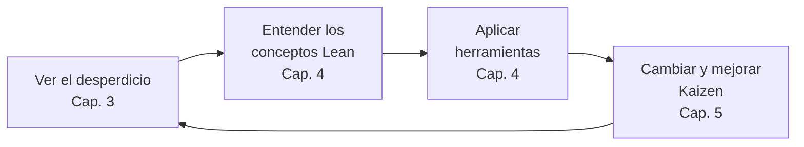
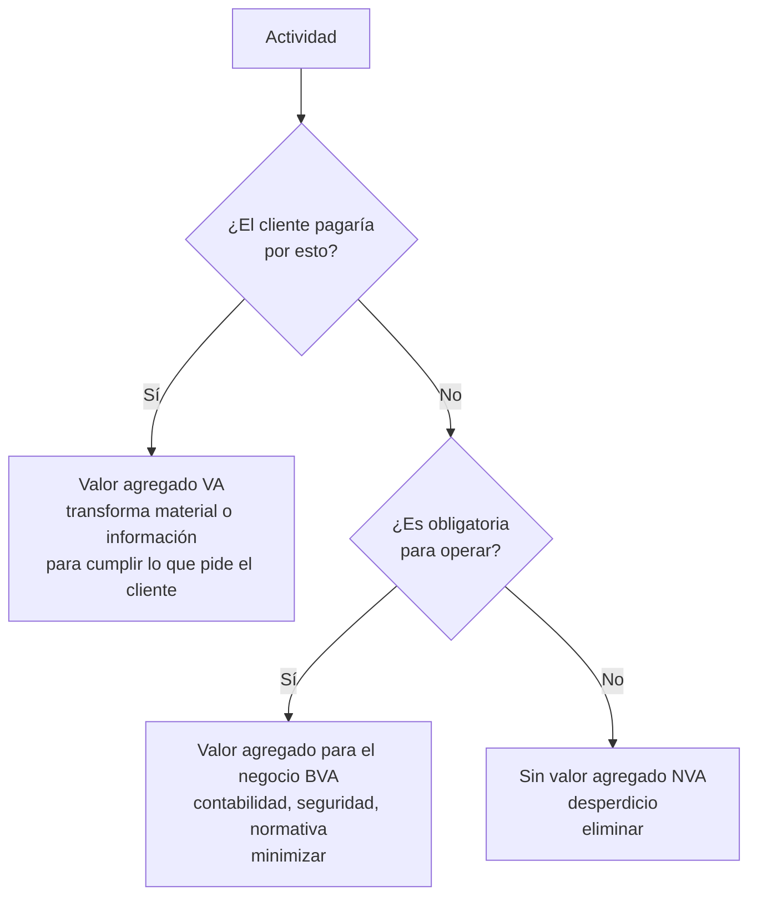
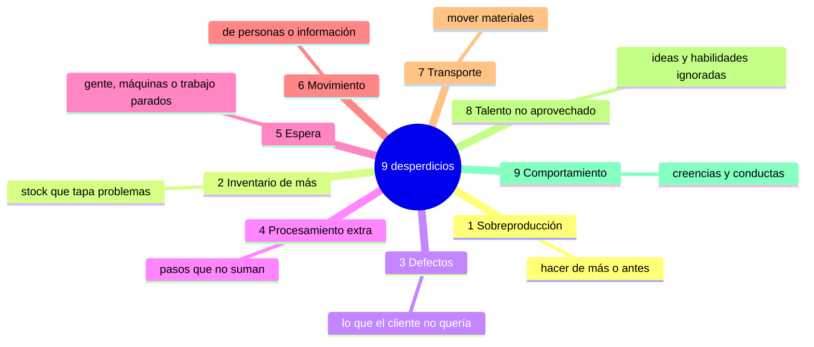
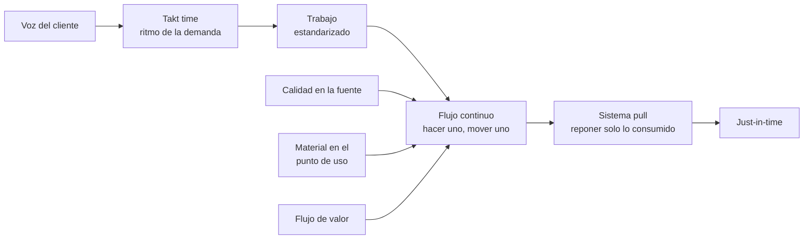
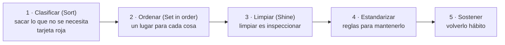
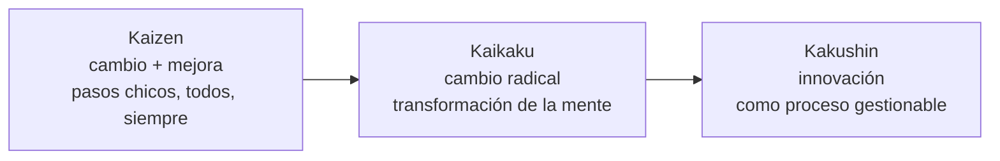
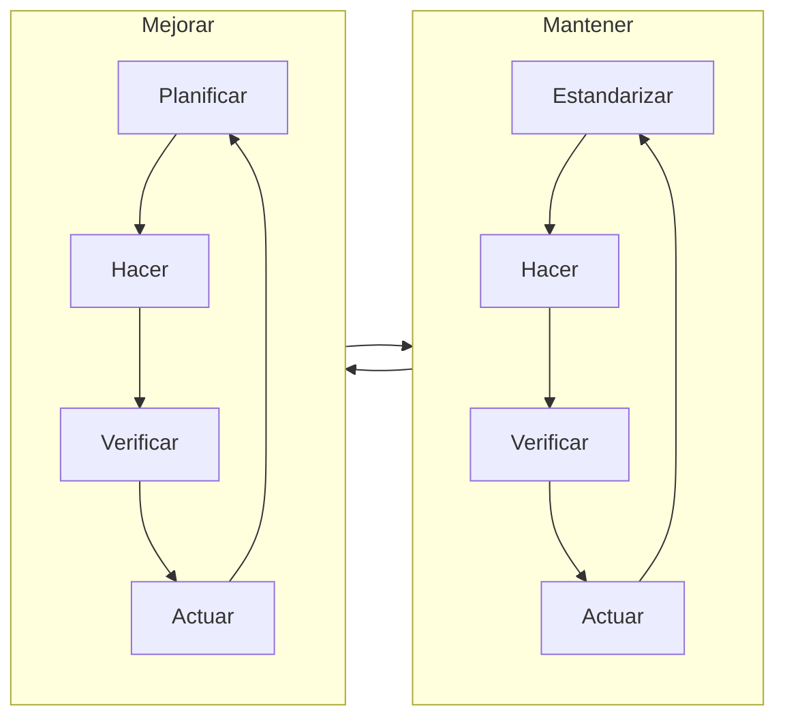

# LSS · Sección 2 — El camino Lean

> **Capítulos:** 3 (Identificación del desperdicio), 4 (Conceptos, herramientas y métodos Lean) y 5 (Las tres caras del cambio: Kaizen, Kaikaku y Kakushin).
> 👉 [Volver al inicio de LSS](/lean-six-sigma/README.md) · [Fichas de repaso](/lean-six-sigma/fichas.md)

## Qué te tiene que quedar

- **Aprender a ver** el desperdicio: los 9 tipos y la diferencia entre lo que agrega valor y lo que no.
- Lean es una **filosofía de gestión**, no una lista de herramientas: "conceptos + herramientas = resultados".
- Las tres formas de cambiar: **Kaizen** (de a poco), **Kaikaku** (cambio de mentalidad) y **Kakushin** (innovación).

La sección se presenta como un ciclo de aprendizaje que cualquiera puede aplicar: **ver el desperdicio → entender los conceptos → aplicar las herramientas**, hasta que salga solo.

**Lean y Six Sigma juntos:** muchos proyectos Six Sigma necesitan que el proceso esté "estable y bajo control" antes de hacer estadística. Lean sirve justamente para **estandarizar primero**. Por eso el ciclo **SDCA** (Estandarizar, Hacer, Verificar, Actuar) va antes del **PDCA** (Planificar, Hacer, Verificar, Actuar).

---

## Capítulo 3 · Identificación del desperdicio

> "No hay nada tan inútil como hacer eficientemente lo que no debería hacerse en absoluto." (Peter Drucker, citado al abrir el capítulo)

### Muda, mura y muri

Las tres "mu" del Sistema de Producción Toyota:

| Término | Significa | Ejemplo en una oficina |
|---|---|---|
| **Muda** | Desperdicio: lo que no agrega valor | Un informe que nadie lee |
| **Mura** | Irregularidad, desnivel, **variación** | Una semana sin pedidos y la siguiente con el triple |
| **Muri** | Sobrecarga, esfuerzo excesivo | Un equipo que trabaja siempre al 120% |

### Variación

- Variación es **cómo difieren los números**. Todo lo que se mide varía: máquinas, personas, instrumentos y hasta la forma en que medimos.
- Se mide en las entradas con las **5M**: Materiales, Máquinas, Mano de obra, Métodos y Mediciones.
- Se grafica con cartas de control: un promedio en el tiempo con un **límite superior** (UCL) y uno **inferior** (LCL). El libro usa el ejemplo del tiempo de entrega (*lead time*) mes a mes.
- Entender y reducir la variación es "la base de toda organización LSS".

### Valor agregado o no

- **Truco del libro:** ponete en los zapatos del cliente externo. Si pagaría por esa actividad, agrega valor.
- Hay dos tipos de NVA: las que existen porque **el proceso está mal diseñado** (mover, esperar, rehacer) y las que **no pide el cliente** pero se hacen igual.

### Cómo se cuela el desperdicio

El caso de la fábrica de neumáticos: envolvían cada neumático en plástico blanco. Nadie sabía por qué, hasta que Charlie, de mantenimiento, con 25 años en la planta, explicó que era para proteger las bandas blancas... de neumáticos que ya no se fabricaban. **Cambió el producto pero no el proceso.**

### El poder de la observación

- Los científicos de los siglos XVI a XIX avanzaron casi solo **observando** y experimentando. En las empresas, en cambio, la observación "casi no existe": la gente camina enfocada en su tarea sin ver el desperdicio que la rodea (las "cataratas organizacionales").
- Un ejercicio que propone el libro: **recorrer el proceso desde el final hacia el principio**, preguntando en cada paso.

### Los 9 desperdicios

Lean clásico reconoce 7 desperdicios (Taiichi Ohno), luego se sumó un octavo (el talento no aprovechado). El libro agrega un **noveno: el comportamiento**.

| # | Desperdicio | Qué es | En un equipo de producto digital se ve como… |
|---|---|---|---|
| 1 | **Sobreproducción** | Hacer más de lo que pide el siguiente paso o el cliente, antes o más rápido. Para muchos, **el peor**: genera casi todos los demás | Features que nadie pidió, documentación que nadie lee (la *Feature Factory*) |
| 2 | **Inventario de más** | Todo lo que supera el flujo pieza a pieza. Se usa para **tapar** procesos que andan mal | Backlog gigante, trabajo empezado y no terminado, ramas sin mergear |
| 3 | **Defectos** | Cualquier cosa que el cliente no quería; obliga a inspeccionar y rehacer | Bugs, incidentes, retrabajo por requisitos mal entendidos |
| 4 | **Procesamiento extra** | Esfuerzo que no agrega valor desde la mirada del cliente | Aprobaciones de más, reportes duplicados, "pulir" lo que nadie va a notar |
| 5 | **Espera** | Gente, máquinas o materiales esperando. Al final, **el que espera es el cliente** | Esperar una revisión, un deploy, una decisión, otra área |
| 6 | **Movimiento** | Movimiento de personas o información que no agrega valor | Saltar entre herramientas, buscar información que no está a mano |
| 7 | **Transporte** | Mover materiales o piezas de un lado a otro | Traspasos (*handoffs*) entre equipos, pasar el trabajo de mano en mano |
| 8 | **Talento no aprovechado** | No usar las capacidades mentales, creativas y físicas de las personas | Devs que solo "ejecutan tickets" y no participan del discovery |
| 9 | **Comportamiento** | Desperdicio que nace de las interacciones humanas y de las creencias | Culpar a personas, guardarse información, "acá siempre se hizo así" |

> **Idea fuerza:** el **comportamiento** es el desperdicio más dañino, porque es la **causa raíz de los otros ocho**. Todo lo que pensamos, decimos y hacemos empuja a crear valor o a crear desperdicio.

- **JIT vs. "por las dudas":** el Sistema Toyota también se llama *just-in-time* (cada cosa se hace cuando se necesita). La sobreproducción es la lógica *just-in-case*.
- **"Cerrar la canilla"** de la sobreproducción requiere coraje: deja a la vista los problemas que estaba escondiendo.

---

## Capítulo 4 · Conceptos, herramientas y métodos Lean

> "Las herramientas Lean Six Sigma no son la respuesta; son el instrumento para aplicar los conceptos. Aprendé los conceptos, aplicá las herramientas, obtené los resultados." (Rich Charron, idea de apertura del capítulo)

### Organización tradicional vs. organización Lean

Una selección de la tabla del libro (en el original hay más de 30 pares):

| Organización tradicional | Organización Lean |
|---|---|
| Foco en la función | Foco en el negocio |
| La gerencia ordena | La gerencia enseña |
| Guiada por el pronóstico | Guiada por el cliente |
| Miedo a fallar, culpar a las personas | Oportunidades de mejora, compartir el éxito |
| Foco en resultados | Foco en procesos |
| Detectar problemas de calidad | Prevenirlos |
| Habilidades acotadas | Personas multihabilidad |
| Guardar información | Compartir información |
| El proveedor es enemigo | El proveedor es aliado |
| El cliente es comprador | El cliente es un recurso |
| Gestión por cantidad de empleados | Las personas que hagan falta |
| Jerarquía, pensamiento de corto plazo | Organización plana, pensamiento balanceado |
| Complejo | Simple |

El ejemplo que desarrolla el libro: la gerencia "por cantidad de empleados" fija la dotación por presupuesto, sin mirar la demanda del cliente; eso genera esperas, defectos y sobrecarga. La gerencia Lean parte de **la voz del cliente** y arma la dotación para cumplirle.

**Lean es para todos:** si la dirección no lo entiende y no lo vive a diario, no funciona. Hace falta un plan para involucrar al **100%** de las personas.

### Conceptos Lean

| Concepto | En pocas palabras |
|---|---|
| **Desperdicio** | Todo lo que el cliente no está dispuesto a pagar |
| **Trabajo estandarizado** | Una forma sistemática y acordada de hacer las tareas que agregan valor. Requisito básico de toda organización LSS |
| **Flujo de valor** (*value stream*) | El camino horizontal que atraviesa la organización desde que llega el pedido del cliente hasta que lo recibe |
| **Gestión del flujo de valor** | Gestionar ese camino completo con conceptos y herramientas LSS |
| **Flujo continuo** | "El Santo Grial": procesar y mover de a una pieza, sin lotes. Pregunta guía: **¿esto que voy a hacer aumenta el flujo?** |
| **Sistema pull** | Solo se repone lo que el cliente consumió. Se implementa con **Kanban** |
| **Punto de uso** (POUS) | Tener los materiales donde se agrega valor |
| **Calidad en la fuente** | Construir la calidad mientras se hace, en vez de "inspeccionarla" al final |
| **Takt time** | El ritmo de la demanda: tiempo disponible ÷ demanda del cliente |
| **Just-in-time** | Producir solo lo necesario, cuando se necesita, en la cantidad necesaria |
| **Kaizen** | Mejora continua (ver Capítulo 5) |
| **5M** | Materiales, Máquinas, Mano de obra, Métodos y Mediciones: las fuentes de variación |
| **KPIV / KPOV** | Variables clave de **entrada** y de **salida** del proceso. Se controlan las entradas para asegurar las salidas |

### Herramientas Lean

| Herramienta | Para qué sirve | Clave |
|---|---|---|
| **5S** | Ordenar y estandarizar el lugar de trabajo. Suele ser lo **primero** que se implementa | Clasificar, Ordenar, Limpiar, Estandarizar, Sostener (ver abajo) |
| **OEE** (Eficiencia general del equipo) | Medir qué tan bien se usa un equipo | Disponibilidad × Rendimiento × Calidad. También se aplica fuera de la fábrica |
| **A prueba de errores** (*poka-yoke*) | Diseñar el proceso para que el error no pueda pasar, o se note enseguida | Prevenir en vez de detectar |
| **Manufactura celular** | Agrupar en una "célula" todo lo necesario para hacer un producto de punta a punta | Suele tener forma de U |
| **Kanban** | Señal visual que dispara la reposición o la producción | Hace realidad el sistema pull |
| **Mapa del flujo de valor** (VSM) | Dibujar el proceso actual y el futuro con tiempos, esperas e inventarios | "Gestionar con mapas" |
| **Controles visuales** | Que el estado del proceso se vea de un vistazo | Tableros, colores, señales |
| **SMED** | Cambiar de un producto a otro en minutos (cambio rápido de herramental) | Permite lotes chicos |
| **TPM** | Mantenimiento productivo total: que los equipos no se rompan | Todos cuidan las máquinas |

#### 5S, paso a paso

- **Tarjeta roja:** al clasificar, se marca lo que está "deseado pero no necesario" con una tarjeta (distinta de la de piezas rechazadas). Preguntas: ¿se necesita?, ¿dónde va?, ¿cuánto hace falta?
- Sin 5S es muy difícil lograr flujo continuo; por eso es la puerta de entrada a Lean.

> **Caso del capítulo:** una célula en U que combina varias herramientas a la vez. Ese es el mensaje: **los conceptos y las herramientas rinden cuando se usan juntos**.

---

## Capítulo 5 · Las tres caras del cambio: Kaizen, Kaikaku y Kakushin

### Resistencia al cambio

Las frases típicas: "si compras hiciera esto…", "si el área de Juan entregara a tiempo…". Las tres fuentes principales de resistencia:

1. **Miedo a lo desconocido.**
2. **Los sistemas de medición** (lo que se mide y premia hoy empuja a seguir igual).
3. **Las creencias** (el desperdicio de comportamiento).

Para superarlas hay que **dejar atrás creencias viejas** y **considerar posibilidades nuevas**. El cambio empieza por uno mismo.

### Las tres caras

### Kaizen · Mejora continua

- **Kai** = desarmar y hacer de nuevo; **Zen** = pensar, iluminarse. Kaizen = **cambio + mejora**, con pasos chicos e involucrando a todos. El término lo popularizó **Masaaki Imai** (1986).
- La gerencia tiene dos roles: **mantener** (estandarizar y sostener: SDCA) y **mejorar** (llevar el proceso a otro nivel: PDCA).

- **Por dónde empezar:** las **4 K**: cosas que huelen mal (*kusai*), que son difíciles o están en zonas oscuras (*kitsui*), que están sucias (*kitanai*) o que son peligrosas (*kiken*).

**Tres formas de hacer Kaizen:**

| Forma | Qué es | Pasos |
|---|---|---|
| **Kaizen y vos** | Mejoras chicas que cualquiera hace en su puesto | Dejá de hacer lo innecesario → si no podés, reducilo → si no, probá otra forma. Tres leyes: **escribí la idea, implementala, compartila** |
| **Kaizen para resolver problemas** | Mejorar un proceso mientras está andando | 1) Ir al **gemba** (el lugar real) · 2) Revisar el **gembutsu** (los objetos y datos del problema) · 3) Contramedidas temporales en el momento · 4) Encontrar la causa raíz · 5) Estandarizar para que no vuelva |
| **Equipos Kaizen** | Proyectos más grandes que lo que una persona puede hacer; eventos de 2 a 4 días o de varias semanas | Preparación, roles claros y manejo de obstáculos |

- **Gemba** es el lugar más importante de la empresa: donde se crea el valor. Soichiro Honda no tenía oficina de presidente; estaba siempre en el gemba.
- En el gembutsu se pregunta **sin buscar culpables**: es una búsqueda de hechos.

**10 atributos de Kaizen** (resumidos): involucra a todos; piensa en procesos; se enfoca en lo que **sí** se puede hacer; redefine el rol de la gerencia; está orientado al proceso más que al resultado; usa SDCA y PDCA; pone primero la calidad; pone primero al cliente, "incluso antes que al jefe"; considera cliente al **paso siguiente** del proceso; y "no es un jonrón, es un sencillo".

### Kaikaku · Transformación de la mente

- **Kai** = desarmar y hacer de nuevo; **Kaku** = alterar radicalmente.
- No es un evento: es el resultado de **aprender y hacer Lean una y otra vez** hasta que se vuelve parte de uno. Se reconoce cuando la persona usa varias herramientas a la vez y piensa en todo el flujo de valor.
- El libro lo muestra en el diseño de células y en el rediseño del layout de plantas.

### Kakushin · Innovación

- La innovación también es un **proceso** que se puede definir, gestionar y mejorar.
- El crecimiento viene de cuatro estrategias: expansión geográfica; alianzas y fusiones; más penetración de mercado; y **desarrollo de productos**, que es la base de casi todo lo demás.
- El libro presenta el **proceso de innovación 20-20**, con seis "esenciales" y perfiles de personalidad para evaluar las fortalezas de innovación de una persona o un equipo.
- Cierra con un modelo de cambio en etapas: crear sentido de urgencia, formar una coalición, comunicar la visión, empoderar y anclar el cambio en la cultura (las etapas de Kotter).

> **Idea fuerza:** Kaizen es la vía de entrada; muchos Kaizen juntos producen Kaikaku; y Kakushin asegura que la organización, además de mejorar, crezca.

---

## Preguntas de repaso

1. ¿Qué significan muda, mura y muri?
2. ¿Cómo decidís si una actividad agrega valor? ¿Qué es una actividad BVA?
3. Nombrá los 9 desperdicios. ¿Cuál es "el peor" y cuál "el más dañino" según el libro?
4. ¿Qué enseña la historia del plástico de los neumáticos?
5. Dá tres diferencias entre una organización tradicional y una Lean.
6. ¿Qué es el flujo continuo y qué pregunta conviene hacerse antes de cada cambio?
7. ¿Qué diferencia hay entre un sistema push y uno pull?
8. ¿Cuáles son las 5S?
9. ¿Por qué SDCA va antes que PDCA?
10. ¿Cuáles son los cinco pasos de Kaizen para resolver problemas?
11. ¿Qué diferencia hay entre Kaizen, Kaikaku y Kakushin?
