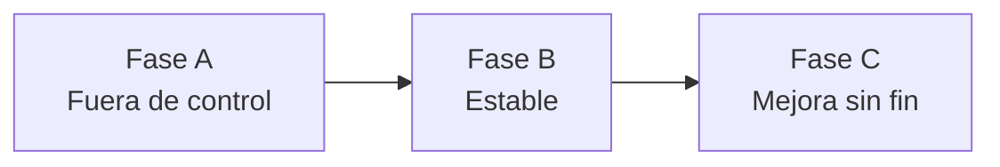
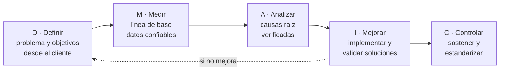
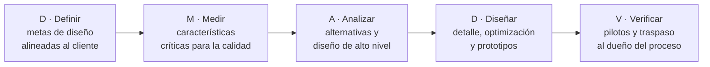
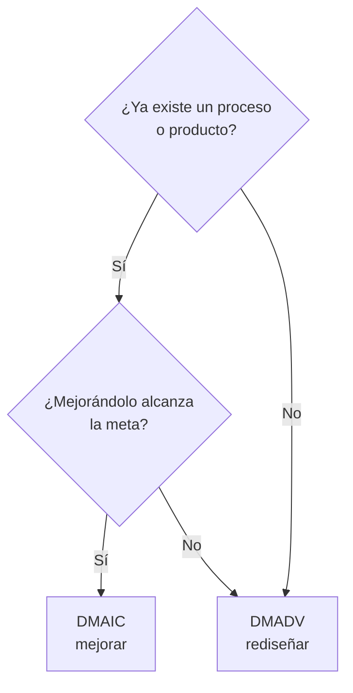

# LSS · Sección 3 — Six Sigma: DMAIC y DMADV

> **Capítulo:** 6 (Integrar LSS y DMAIC con DMADV), más la introducción de la Sección 3 sobre el origen de Six Sigma.
> 👉 [Volver al inicio de LSS](/lean-six-sigma/README.md) · [Fichas de repaso](/lean-six-sigma/fichas.md)

## Qué te tiene que quedar

- Qué significa "seis sigma" y de dónde sale el famoso **3,4 defectos por millón**.
- Las dos rutas de Six Sigma: **DMAIC para mejorar** un proceso que existe y **DMADV para diseñar** uno nuevo.
- Cómo encajan las herramientas Lean dentro de cada fase.
- Por qué el **análisis de causa raíz** es el punto de encuentro entre Lean y Six Sigma.

---

## Qué es "seis sigma"

- **Sigma (σ)** es la desviación estándar: cuánto se dispersan los resultados alrededor del promedio.
- El término lo propuso **Bill Smith** en Motorola: el estándar de todo proceso tenía que ser **3,4 defectos por millón de oportunidades** (DPMO).
- Six Sigma se apoya en dos ideas:
  1. **Cuanto menos variación alrededor del centro de la especificación, menos chances de defecto.** (Idea aceptada desde los años 40, popularizada por Taguchi en los 70. Shewhart ya usaba ±3σ en sus cartas de control en los años 20.)
  2. **Los procesos se corren con el tiempo.** Motorola supuso un corrimiento de ±1,5σ a largo plazo. Por eso un proceso diseñado a 6σ (**Cp = 2**) termina rindiendo como uno de 4,5σ (**Cpk = 1,5**), y eso equivale a 3,4 DPMO.
- Motorola consideraba inalcanzable el "cero defectos" de Phil Crosby, así que fijó una meta concreta y medible.

### Niveles sigma (largo plazo, con el corrimiento de 1,5σ)

| Nivel sigma | Defectos por millón (DPMO) | Rendimiento |
|---|---|---|
| 2σ | ≈ 308.500 | ≈ 69% |
| 3σ | ≈ 66.800 | ≈ 93,3% |
| 4σ | ≈ 6.200 | ≈ 99,4% |
| 5σ | ≈ 230 | ≈ 99,98% |
| **6σ** | **3,4** | **99,99966%** |

> ⚠️ **Ojo con un error del libro:** en la introducción de la Sección 3 dice que ±3σ equivale a "66,8 defectos por millón". El valor estándar es **unos 66.800 DPMO** (93,3% de rendimiento). Si te lo preguntan, usá la tabla.

---

## Lean y Six Sigma: distintos pero compatibles

| | Lean | DMAIC / DMADV |
|---|---|---|
| Objetivo | Identificar y eliminar **desperdicio** | Identificar y eliminar **variación** |
| Naturaleza | Mayormente **cualitativa**: todo se tiene que poder rastrear a la demanda del cliente, el flujo continuo y la perfección | **Cuantitativa**, basada en el **método científico** |
| Fortaleza | Velocidad, simplicidad, aprendizaje rápido | Diálogo basado en hechos entre la dirección y los equipos |

- El método científico, según la cita del libro, se apoya en cuatro valores: **curiosidad, apertura a ideas nuevas, escepticismo y pensamiento crítico**.
- Deming decía que no hace falta ser experto en ciencia para usar el pensamiento científico, igual que no hace falta saber mecánica para manejar.
- **Lo que aporta Lean al conocimiento:** ciclos de aprendizaje **cortos y frecuentes** y **compromiso postergado** (Toyota arma varios caminos posibles y los va descartando de a poco, decidiendo lo más tarde posible, con la mayor información).
- **El punto ciego de Lean:** a veces le falta lo mejor de Six Sigma, la conversación con datos entre líderes y equipos.

### Lean Design

- "En el entorno actual, **la velocidad es la moneda**." Los ganadores se definen en semanas, no en años.
- Muchas empresas tienen un proceso de desarrollo de producto "en papel" que nadie sigue, porque es una copia de otro lado, una "mejor práctica" vieja o algo que vendió un consultor. Termina tan pesado que **invita a saltearlo**.
- Lean Design propone métodos simples y flexibles. Para empezar, el libro recomienda **bajar costos** (la vía más rápida a resultados medibles), antes que acelerar el desarrollo o innovar, que exigen cambios más disruptivos.
- En el centro está la definición de **valor: lo que el cliente está dispuesto a pagar**. Todo lo demás es desperdicio, y conviene eliminarlo **al diseñar**, no años después.

---

## DMAIC · Mejorar un proceso que ya existe

| Fase | Qué se hace | Preguntas guía |
|---|---|---|
| **Definir** | Elegir el proyecto y definir el problema en términos de lo que es crítico para el cliente. Los objetivos más importantes salen de los clientes | ¿Qué problema resolvemos? ¿Para quién? ¿Qué significa "mejor"? |
| **Medir** | Juntar datos del desempeño actual, armar métricas válidas y una **declaración cuantitativa** del problema | ¿Dónde estamos hoy? ¿Los datos son confiables? |
| **Analizar** | Encontrar la brecha entre lo actual y la meta, y **verificar** las causas raíz con herramientas estadísticas | ¿Por qué pasa? ¿Lo podemos demostrar? |
| **Mejorar** | Ser creativo para hacerlo mejor, más barato o más rápido; implementar y **validar con datos**. Si no hay mejora, volver a Definir | ¿Qué cambiamos? ¿Funcionó? |
| **Controlar** | Institucionalizar el cambio: procedimientos, incentivos, presupuestos, documentación y monitoreo estadístico. Ver si se puede replicar y registrar lecciones aprendidas | ¿Cómo evitamos volver atrás? |

DMAIC funciona como un **proceso con compuertas** (*tollgates*): cada fase se aprueba antes de pasar a la siguiente. Le da a todos los equipos un mismo mapa.

## DMADV · Diseñar algo nuevo

| Fase | Qué se hace |
|---|---|
| **Definir** | Qué se diseña y por qué. Se usa QFD o el proceso analítico jerárquico para alinear con el cliente y la estrategia |
| **Medir** | Traducir la voz del cliente en **CTQ** (características críticas para la calidad) y en metas del proyecto |
| **Analizar** | Generar conceptos, compararlos con los mejores diseños del mercado y elegir el mejor |
| **Diseñar** | Completar el detalle con modelos predictivos, simulación, prototipos y pilotos |
| **Verificar** | Probar el diseño en el mundo real y entregárselo a los dueños del proceso |

DMADV es parte de **Design for Lean Six Sigma** (DFSS). Invita a pensar: "si un genio me diera tres deseos y una varita mágica, ¿cómo sería el proceso perfecto?".

### ¿Cuál uso?

> **Regla para recordar:** **DMAIC para mejorar procesos, DMADV para diseñar procesos nuevos.**

---

## Herramientas Lean Six Sigma por fase

Una versión resumida de la tabla del capítulo. No hay que usar todas en cada proyecto: es un menú.

| Fase | Herramientas típicas |
|---|---|
| **Definir** | Acta del proyecto (*project charter*), requisitos del cliente, medidas Lean, plan Kaizen, mapa del flujo de valor (VSM), matrices de voz del cliente, **SIPOC**, diagrama de árbol KJ |
| **Medir** | Benchmarking, mapas del estado actual (traspasos, diagrama de espagueti, flujos), checklists de los 9 desperdicios, estadística descriptiva, **Pareto** de defectos |
| **Analizar** | **5 Porqués**, **diagrama de causa y efecto**, diagramas de árbol y matrices, VSM, diseño de experimentos, pruebas de hipótesis, **FMEA**, simulación |
| **Mejorar** (o Diseñar) | Las herramientas Lean "clásicas": **5S**, calidad en la fuente, punto de uso, trabajo estandarizado, células, TPM, layout, SMED, reducción de lotes, **Kanban**, controles visuales, eventos Kaizen; mapas del estado futuro |
| **Controlar** (o Verificar) | Planes de acción Kaizen, indicadores visuales, plan de formación y de comunicación Lean, **control estadístico de procesos** (SPC), FMEA de proceso, sistema de monitoreo |

**Patrón para recordar:** los **conceptos** Lean (desperdicio, valor agregado) aparecen sobre todo en las primeras fases, para **entender el estado actual**. Las **herramientas** Lean aparecen en Mejorar y Controlar, cuando se **actúa**.

## Análisis de causa raíz: donde se cruzan Lean y Six Sigma

- El **análisis de causa raíz** (RCA) es el punto en común. La diferencia es que Lean usa tanto técnicas **cualitativas** como cuantitativas: 5 Porqués, causa y efecto y FMEA son comunes a ambos.
- El RCA solo no produce resultados: tiene que ser parte de una actitud de **mejora implacable** en todas las áreas.
- Las herramientas se agrupan según su uso: para generar causas posibles, para juntar datos, para priorizar, para verificar. Ver la [página de herramientas](/lean-six-sigma/herramientas.md) y el método de **6 pasos** de causa raíz.

> **Idea fuerza:** los líderes no tienen que saber manejar cada herramienta, pero sí **leer e interpretar** sus resultados para pedir la herramienta correcta, cuestionar conclusiones y destrabar equipos.

---

## Preguntas de repaso

1. ¿Qué es sigma y qué significa "3,4 DPMO"?
2. ¿Por qué un proceso 6σ se considera de 4,5σ a largo plazo?
3. ¿Qué diferencia de fondo hay entre el enfoque de Lean y el de DMAIC/DMADV?
4. Nombrá las fases de DMAIC y qué se hace en cada una.
5. Nombrá las fases de DMADV. ¿En qué se diferencia de DMAIC?
6. ¿Cuándo conviene DMADV en lugar de DMAIC?
7. ¿Qué es el "compromiso postergado" de Toyota?
8. ¿Por qué el análisis de causa raíz une a Lean con Six Sigma?
9. Nombrá dos herramientas típicas de Definir, dos de Analizar y dos de Controlar.
