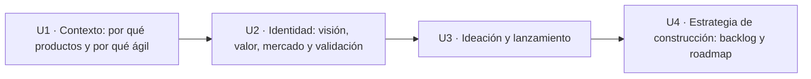

# Módulo 1 · Introducción y Conceptos Fundacionales del Product Management

Es el módulo de base: qué es un producto, qué hace un Product Manager, cómo se piensa en ágil y cómo se define y valida un producto antes de construirlo.

| Unidad | Estado |
|---|---|
| [U1 · Introducción y Contexto](/modulo-1/unidad-1/README.md) · [fichas](/modulo-1/unidad-1/fichas.md) | ✅ |
| [U2 · Identidad y Diferenciación de Productos](/modulo-1/unidad-2/README.md) · [fichas](/modulo-1/unidad-2/fichas.md) | ✅ |
| [U3 · Ideación y Lanzamiento de Productos](/modulo-1/unidad-3/README.md) · [fichas](/modulo-1/unidad-3/fichas.md) | ✅ |
| [U4 · Estrategia de Construcción del Producto](/modulo-1/unidad-4/README.md) | ⏳ |

## Hilo conductor

