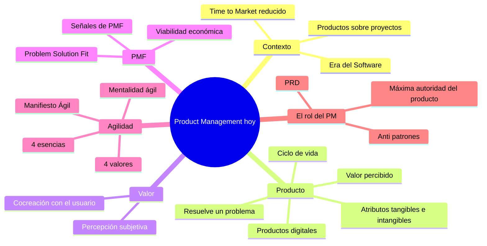
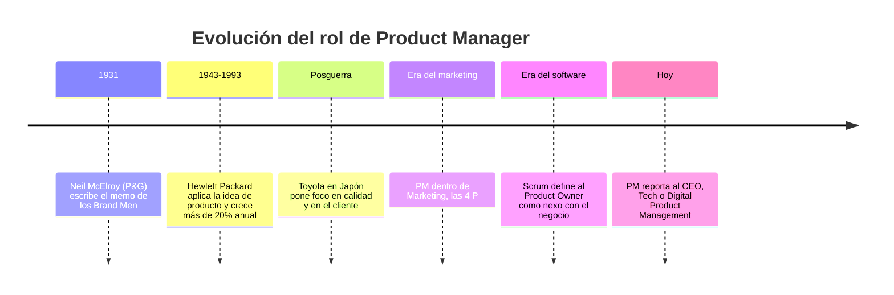
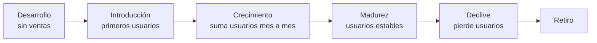
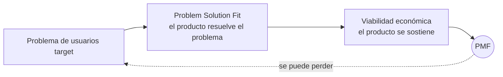
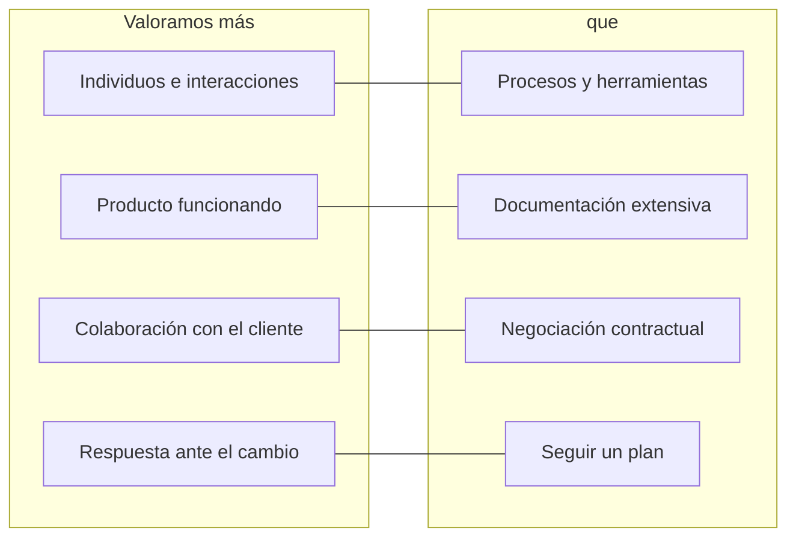
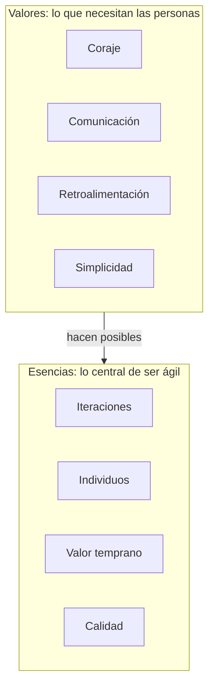
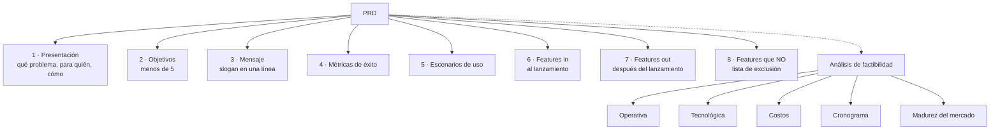

# M1 · U1 — Introducción y Contexto

> **Módulo 1:** Introducción y Conceptos Fundacionales del Product Management
> Unidad fundacional y de referencia: el contexto en el que se crean productos hoy, qué es un producto, su ciclo de vida, el PMF y las bases de la agilidad.
> 👉 [Fichas de repaso](/modulo-1/unidad-1/fichas.md) · [Apuntes de la clase del 11/11](/modulo-1/unidad-1/clase-11-11.md)

## Objetivos de la unidad

- Entender el contexto actual en el que se crean y desarrollan productos.
- Conocer los elementos esenciales de un producto y su ciclo de vida.
- Entender qué es el PMF (Product Market Fit).
- Incorporar los conceptos fundamentales de las metodologías y marcos ágiles.

## Mapa conceptual

---

## 1. Contexto y Time to Market

- **Time to Market (extendido):** el tiempo desde que se detecta una necesidad hasta que la solución está en el mercado y disponible. Antes se medía en meses o años; hoy puede ser días o semanas.
- Las tecnologías combinadas aceleraron el cambio: iPod, Google, Facebook, YouTube, iPhone, MercadoLibre, Uber, Netflix, Spotify, Tinder, drones, Google Duplex, Tesla, COVID-19, explosión de datos.
- También pesan los **cambios generacionales**: las nuevas generaciones (por ejemplo la Generación Y) crecen en un mundo más diverso y complejo, y ya son la fuerza laboral principal.

> **Idea fuerza:** los grandes cambios aceleraron un modelo de gestión y comercial basado en **productos** por sobre proyectos u operaciones tradicionales.

## 2. Introducción al Product Management

- **Origen:** 1931, memo de **Neil McElroy** en Procter & Gamble describiendo a los *Brand Men*, responsables de la marca desde las ventas hasta la gestión del producto.
- McElroy inspiró a **Hewlett y Packard**, que llevaron la idea de "producto" a HP.
- En el Japón de posguerra, **Toyota** puso foco en la calidad y en las sugerencias de clientes y empleados.
- Los primeros PMs vivían en **Marketing**: el *marketing mix* de las **4 P** (Product, Place, Price, Promotion).
- **Hoy:** el Product Management depende de la alta dirección (reporta al CEO), porque "el producto es, en esencia, la organización", y debe estar alineado con la visión y misión organizacional.

> **Postura de la cátedra:** la visión de Scrum del Product Owner como "nexo con el negocio" está atrasada. El Product Manager **es el negocio**: es el máximo responsable de todo lo que concierne al producto, incluido su equipo de desarrollo.

## 3. La Era del Software

El software ya no es un componente más de la cadena de valor: muchas veces **es** la ventaja competitiva (MercadoLibre, NuBank, Google Maps, Zoom, WhatsApp, LinkedIn son "esencialmente software"). Incluso productos tradicionales tienen software: el espumador de Nespresso con app, el piloto automático de Tesla, los televisores modernos.

**Software vs. "Hard" (lo físico):**

| En software… | Comparado con lo físico |
|---|---|
| El costo de cambio es mucho menor | Cambiar una app vs. rediseñar el teléfono |
| La distribución puede ser instantánea | Remodelar un local lleva meses |
| Escala de forma exponencial | Un local escala con empleados, espacio y stock |
| Opera 7x24 y globalmente | Harían falta millones de puntos de atención |
| Los datos son parte natural del proceso | En lo físico hay que capturarlos y digitalizarlos |
| El costo de servir a un cliente nuevo es marginal | Cada cliente nuevo cuesta |

> **Idea fuerza:** hay que pensar **"Software Primero"**. El mundo se rige por cómo se construye, escala, diseña, despliega y experimenta el software, seguido de datos e IA.

## 4. Cocreación de Valor

- **Valor = la percepción de un beneficio, una utilidad o una importancia de algo.**
- Es **subjetivo**: depende de quién lo evalúe y de cuándo.
- Se habla de **cocreación** (no de "entrega"): el valor no lo genera solo el proveedor, sino el proveedor **y** el consumidor.
- Origen del término: artículo de **Harvard Business Review (2000)** (Prahalad y Ramaswamy). Gracias a Internet, los consumidores "salieron de la audiencia y subieron al escenario".
- Las redes sociales potenciaron la cocreación **explícita** (opiniones en canales) e **implícita** (análisis de datos de comportamiento).
- El COVID-19 mostró que el mismo producto puede cambiar de valor sin cambiar en sí (higiene, delivery).

## 5. ¿Qué es un producto?

- Etimología: del latín *productus*, "producido, logrado"; *pro* (delante) + *ductus* (conducido).
- Incluye **servicios** (productos "no materiales": Internet, un hotel).
- Es el punto central de la oferta de una organización a su mercado meta.
- **En esencia, un producto es la respuesta concreta a un problema.**

| Autor/fuente | Definición |
|---|---|
| Bonta y Farber | Conjunto de atributos que el consumidor considera que tiene un bien para satisfacer sus necesidades. Dos dimensiones: características objetivas y criterios subjetivos (imagen, marca). |
| Stanton, Etzel y Walker | Conjunto de atributos tangibles e intangibles: empaque, color, precio, calidad, marca, servicios y reputación. Puede ser un bien, servicio, lugar, persona o idea. |
| McCarthy y Perrault | La oferta con que una compañía satisface una necesidad. |
| AMA (American Marketing Association) | Conjunto de atributos (características, funciones, beneficios, usos) que le dan capacidad de ser intercambiado o usado. |

> **Definición de la cátedra:** un producto tiene un conjunto de atributos **tangibles e intangibles** que los usuarios perciben como **valor** (real o potencial), y es una **forma de resolver un problema**.

## 6. Ciclo de vida del producto

| Etapa | Cómo se reconoce | Foco del PM |
|---|---|---|
| Introducción | Pocos o ningún usuario | Entender funcionalidades y mercado, adaptarse |
| Crecimiento | Suma muchos usuarios (o más uso) mes a mes | Escalar y balancear soporte a existentes y nuevos |
| Madurez | Cantidad de usuarios estable | Retención |
| Declive | Pierde usuarios mes a mes | Evitarlo, o planificar el retiro |

- Hay modelos **atemporales**: un mercado con usuarios target con necesidades no satisfechas (*underserved*), donde el PM crea valor con *feature sets* y UX, refinando el producto en un ciclo infinito.
- **Regla simple:** mirar la cantidad de usuarios (o el uso) en el tiempo. Un buen PM busca que su producto crezca o, al menos, se mantenga estable.

## 7. PMF · Product Market Fit

- **PMF:** estado en el que el producto alcanzó el **Problem Solution Fit** (está validado que resuelve el problema de los usuarios target) **y** es **económicamente viable**. También: un mercado suficientemente amplio que lo "compra" y crecimiento constante.
- **Marc Andreessen** (cofundador de Netscape): sin PMF, no hay boca a boca, el uso no crece, las ventas tardan. Con PMF, los clientes compran tan rápido como podés producir y la prensa te busca.
- No es una ciencia exacta: es una **apreciación del PM**.

**Señales de PMF según Lenny Rachitsky (ex Airbnb):**

1. **Emoción visible:** "¿se les dilatan las pupilas?". La mejor prueba: que paguen por adelantado.
2. **Retención:** en el análisis de **cohortes**, la curva de usuarios activos se **aplana**.
3. **Encuestas:** un porcentaje alto (por ejemplo **40%**) estaría **muy decepcionado** si el producto desapareciera.
4. **Crecimiento orgánico** exponencial por boca a boca.
5. **CAC menor que LTV:** adquirir un cliente cuesta menos que lo que vale en su vida útil.
6. **Lo usan aunque esté roto** (Elad Gil: Twitter caído y nadie se iba).

> **Idea fuerza:** el PMF **no es un momento único**. Los competidores mejoran, los mercados cambian: se puede tener, perder y reencontrar.

## 8. Productos digitales

- No físicos, construidos y comercializados con tecnologías de la información: streaming, eBooks, cursos online, software, herramientas web, videojuegos, apps.
- Son la "estrella" de los emprendedores por su **alcance** y **escalabilidad** (multiplicar ingresos sin aumentar costos en la misma proporción).
- Contracara: el mercado es **mucho más competitivo**.

## 9. El Manifiesto Ágil

Firmado el **12 de febrero de 2001** en **Snowbird, Utah**, por **17 personas**. Nació para el software y se extendió a otras industrias; hoy es esencial en Product Management.

- **Individuos e interacciones:** los procesos y herramientas ayudan, pero se adaptan a las personas y no al revés.
- **Producto funcionando:** la única medida real de avance es entregar un producto que funciona.
- **Colaboración con el cliente:** el cliente como un miembro más del equipo, sobre un marco contractual de alto nivel y confianza.
- **Respuesta ante el cambio:** anticipación y adaptación con feedback constante y planificación continua.

> Lo de la derecha **no** se descarta: se valora más lo de la izquierda.

## 10 y 11. Esencias y valores ágiles (visión de la cátedra)

Ojo: **Scrum no es todo Agile.** Es el marco más difundido, pero no lo agota.

| Esencia | En una frase |
|---|---|
| **Iteraciones** | Iterando se aprende: todo lo hacemos de forma iterativa |
| **Individuos** | Las personas no son máquinas: skills, emociones, convicciones |
| **Valor temprano** | Buscar siempre la vía que entregue valor lo antes posible |
| **Calidad** | Calidad bien entendida es productividad y efectividad |

| Valor | En una frase |
|---|---|
| **Coraje** | Ser ágil no es fácil: animarse a decir "eso no es Agile" |
| **Comunicación** | Buenas y honestas comunicaciones, la única forma de llegar a las personas |
| **Retroalimentación** | Reflexionar y mejorar seguido, para no confundir el medio con el fin |
| **Simplicidad** | Si es muy complejo, no es ágil |

## 12. Mentalidad ágil

Es un **cambio de paradigma**, no solo seguir un proceso:

- Enfocar el esfuerzo en la **cocreación de valor**.
- Sumar al **usuario** como parte del proceso.
- Aceptar la **incertidumbre** con iteraciones y adaptación.
- Maximizar el **aporte humano** (creatividad, innovación).

Por qué: (1) un producto evoluciona con el tiempo; (2) el objetivo es crear valor, no cumplir un plan; (3) es casi imposible lograr lo mejor en un solo intento.

> **Idea fuerza:** la mentalidad ágil es reconocer el estado actual y actuar en consecuencia.

## 13. Anti patrones de Product Management

Un **anti patrón** (o trampa) es una mala solución para un problema, como "reinventar la rueda".

| # | Anti patrón | Qué pasa | Antídoto |
|---|---|---|---|
| 1 | **Feature Factory** | Se agregan funcionalidades sin evaluar para qué ni para quién | Analizar y validar antes de construir |
| 2 | **Buscar problemas para soluciones** | Se intenta convencer al usuario de que necesita lo que ya tenemos | Partir del problema; si es bueno, solo hay que mostrarlo |
| 3 | **Foco en la solución y no en el problema** | Se abandona temprano la exploración del problema | Entender bien el dominio y plantear soluciones distintas |
| 4 | **Usuarios no definidos** | No se sabe quién va a usar el producto | Conocer a fondo a los usuarios (User Personas) |
| 5 | **No validar hipótesis** | Se construye una "propuesta" sin comprobarla | Preguntar: "si tuvieras esto, ¿resolvería tu problema?" |
| 6 | **Fechas arbitrarias** | Presión por fechas sin razón | Fijar fecha y ajustar alcance: "¿qué tenemos en 2 semanas?" |
| 7 | **Zombie Feature** | Funcionalidades sin uso que nunca se retiran | "Menos es más": retirar lo que no se usa |
| 8 | **Full Quality** | Todo recibe máxima calidad | Calidad **adecuada** a cada caso |
| 9 | **Navaja Victorinox** | El producto hace de todo y nada con excelencia | Hacer muy bien pocas cosas (o una) |
| 10 | **Más de un PM** | Dos conductores para un mismo vehículo | Una sola persona define el rumbo, con trabajo en equipo |
| 11 | **PM sin autoridad** | Formalmente conduce, pero no tiene el volante | El PM toma las decisiones del producto (y rinde cuentas) |
| 12 | **Proxy Product Manager** | El PM es un "mozo" entre el negocio y el equipo | El PM es el negocio, no un intermediario |

## 14. PRD · Product Requirements Document

Documento que concentra el análisis previo a decidir crear un producto; suele usarse para presentar a inversores y sponsors.

**Análisis de factibilidad:**

- **Operativa** (la más importante): ¿qué tan bien resuelve el problema o explota la oportunidad? ¿Encaja con la visión? ¿Es sostenible? ¿Tenemos recursos?
- **Tecnológica:** ¿tenemos la tecnología? ¿Es riesgosa? ¿Qué futuro tiene?
- **Costos:** inversión inicial (*up-front*), costos *on-going*, mantenimiento, relación costo-beneficio y de dónde sale el *funding*.
- **Cronograma:** ¿se puede en los tiempos que necesita la organización? ¿Son razonables las estimaciones?
- **Madurez del mercado:** ¿está listo el mercado? (ejemplo: Google Glass, adelantado a su tiempo).

## 15. Conclusiones

El foco está cada vez más en los productos, tradicionales o digitales, y en este contexto emerge el **Product Manager como máxima autoridad del producto**.

---

## Autores y referentes citados

| Persona | Por qué aparece |
|---|---|
| Neil McElroy | Memo de 1931 en P&G: nacimiento del Product Management |
| Bill Hewlett y David Packard | Llevaron la idea de producto a HP |
| Prahalad y Ramaswamy (HBR, 2000) | Concepto de cocreación de valor |
| Bonta y Farber; Stanton, Etzel y Walker; McCarthy y Perrault; AMA | Definiciones de producto desde el marketing |
| Marc Andreessen | Definición de PMF |
| Lenny Rachitsky | Señales para alcanzar el PMF |
| Elad Gil | "Si lo usan roto, hay PMF" |

## Preguntas de repaso

1. ¿Qué es el Time to Market extendido y por qué se redujo?
2. ¿Dónde y cuándo nace el Product Management?
3. ¿Por qué la cátedra dice que el PM "es el negocio"?
4. Nombrá cuatro diferencias entre el software y lo físico.
5. ¿Por qué se habla de **co**creación de valor?
6. ¿Cuál es la definición de producto de la cátedra?
7. ¿Cómo reconocés en qué etapa del ciclo de vida está un producto?
8. ¿Qué dos condiciones definen el PMF? Nombrá tres señales.
9. ¿Cuáles son los 4 valores del Manifiesto Ágil?
10. Diferenciá las esencias de los valores ágiles.
11. Elegí tres anti patrones y explicá su antídoto.
12. ¿Qué secciones tiene un PRD y qué factibilidades se analizan?

Respuestas en las [fichas de repaso](/modulo-1/unidad-1/fichas.md).
