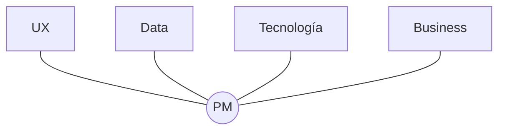
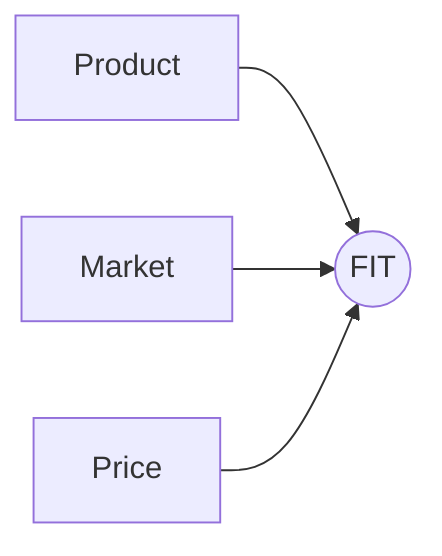
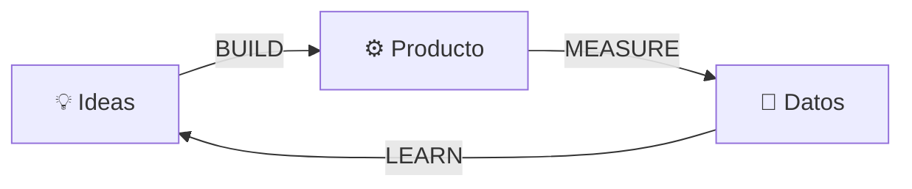

# Apuntes de clase · 11/11

> Notas tomadas en la clase en vivo. Complementan el [resumen de la U1](/modulo-1/unidad-1/README.md).

## Datos de cursada

- Para obtener el diploma **hay que rendir el examen final**.
- El **TP es optativo**.

## ¿Qué es un Product Manager?

Es **la voz del consumidor dentro de la compañía**: se asegura de que se escuche y se siga al mercado (enfoque **customer-centric**).

El PM está en el centro de cuatro mundos:

Un perfil en el que se busca:

- **Enfoque en el usuario:** que las decisiones de producto se centren en las necesidades y deseos del usuario final.
- **Coordinación interfuncional:** facilitar la comunicación y colaboración entre equipos hacia un mismo objetivo.
- **Visión estratégica:** del producto, y de la priorización de características y mejoras según el feedback del mercado y los datos.
- **Agilidad en el desarrollo:** adaptar rápido el producto a cambios y necesidades del usuario.

## El rol cambia según la etapa del producto

| Etapa | Foco del PM |
|---|---|
| Introducción | Búsqueda de la adaptación constante |
| Crecimiento | Escalar con una estabilidad que resista grandes volúmenes |
| Madurez | Retención de usuarios |

El producto vive en un loop constante de **retroalimentación y refinamiento**.

## Matriz BCG

Clasifica productos (o unidades de negocio) según el **crecimiento del mercado** y la **participación relativa** que tienen en él.

| | **Participación alta** (fuerte) | **Participación baja** (débil) |
|---|---|---|
| **Crecimiento alto** | ⭐ **Estrella** | ❓ **Interrogación** |
| **Crecimiento bajo** | 🐄 **Vaca** | 🐕 **Perro** |

| Cuadrante | Crecimiento | Participación | Qué significa |
|---|---|---|---|
| ⭐ **Estrella** | Alto | Alta | Alta inversión y alta participación (rentabilidad) |
| ❓ **Interrogación** | Alto | Baja | Requiere mucha inversión y su participación es nula o negativa |
| 🐄 **Vaca** | Bajo | Alta | Genera fondos y utilidades |
| 🐕 **Perro** | Bajo | Baja | Baja participación y genera pocos fondos |

> En el gráfico de clase el eje horizontal va de **fuerte** (izquierda, 5x) a **débil** (derecha, 0), con el corte en 1. El eje vertical es la tasa de crecimiento de la industria, con el corte en 10%.

## Product Market Fit

El **fit** está en la intersección de tres círculos:

Producto que resuelve el problema, un mercado que lo quiere y un precio que lo hace viable (relacionalo con el punto 7 del [resumen de la U1](/modulo-1/unidad-1/README.md)).

## Metodología Lean: Build, Measure, Learn

1. **Construimos** el producto inicial (MVP) o la funcionalidad.
2. **Medimos.**
3. **Aprendemos** e iteramos: de ahí viene el crecimiento.
