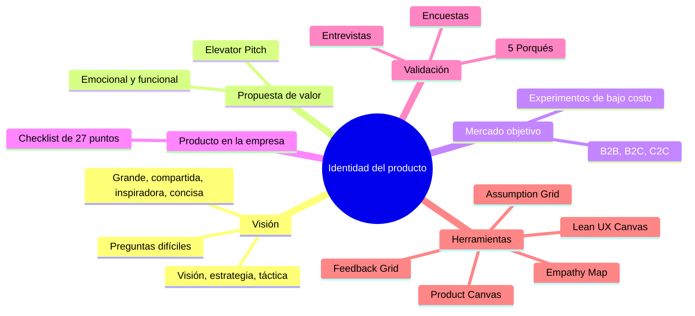
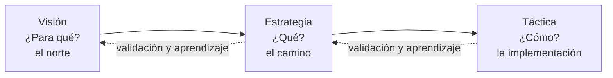
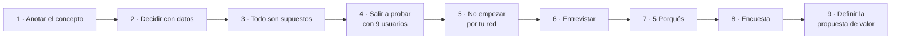
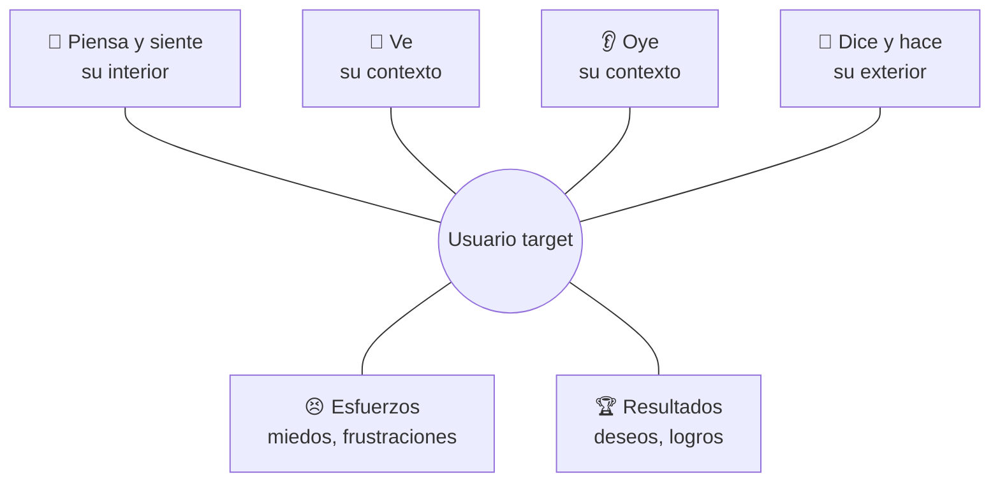
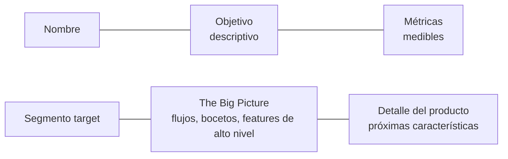
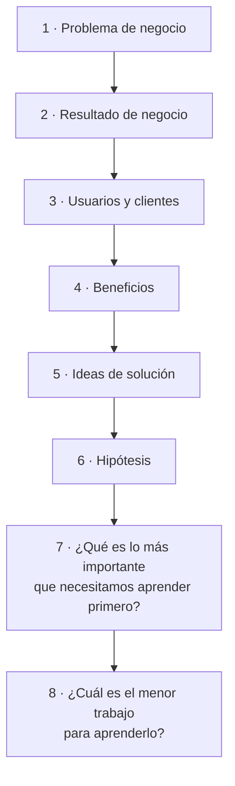
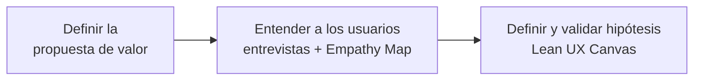

# M1 · U2 — Identidad y Diferenciación de Productos

> **Módulo 1:** Introducción y Conceptos Fundacionales del Product Management
> Cómo definir y comunicar un producto, conocer su contexto y sus usuarios, y validar hipótesis antes de invertir.
> 👉 [Fichas de repaso](/modulo-1/unidad-2/fichas.md) · [Apuntes de la clase del 18/11](/modulo-1/unidad-2/clase-18-11.md) (con videos comentados)

## Objetivos de la unidad

- Entender cómo diseñar un producto.
- Aprender a asumir el rol de Product Manager.
- Adquirir técnicas para pensar soluciones.

## Mapa conceptual

---

## 1. Visión

> "Si no sabes lo que quieres, vas a terminar teniendo muchas cosas que no quieres." (Chuck Palahniuk)

La visión es el **destino** del producto. Según **Roman Pichler** debe ser:

1. **Grande** (alto nivel)
2. **Compartida** (por todo el equipo de construcción y gestión)
3. **Inspiradora** (guía para pensar ideas y evaluar opciones)
4. **Concisa** (un párrafo de hasta 4 renglones)

**Preguntas básicas:** ¿a quién va dirigido? ¿Qué necesidades satisface? ¿Qué atributos críticos definen el éxito? ¿Cómo se compara con lo existente? ¿Cómo y cuánto vamos a ganar? ¿Podemos desarrollarlo con la tecnología y recursos disponibles?

**Preguntas difíciles (scary questions):** ¿por qué no se hizo aún? ¿Qué otras opciones hay? ¿En qué se diferencia? ¿Quién pagaría por él? Pueden destruir la idea, pero ahorran años de esfuerzo.

> **Testarudo con la visión, flexible en los detalles.** Y con una dosis de realidad para distinguir visión de ilusión.

### Visión, estrategia y táctica

La relación no es unidireccional: se retroalimenta con **validación y aprendizaje**, probablemente las dos actividades más importantes de un PM.

**Origen de la visión:** a veces hay un visionario; casi siempre hay varias personas con su propia visión. El PM **facilita** unificarla en una sola. Si no se puede, hay que preguntarse si se trata de **varios productos distintos**.

> "No hay vestido más difícil de diseñar que uno que no sabemos para quién es, ni para qué ocasión."

## 2. Propuesta de valor

- El valor **no es la característica**, sino **lo que el usuario logra** con ella.
- Una propuesta de valor es una **promesa** de resultados y beneficios.
- Tiene dos aspectos: **emocional** (lo que siente) y **funcional** (lo que obtiene).

**Ejemplo:** "Nespresso hace que sea fácil disfrutar de café con calidad de cafetería a un precio aceptable en tu propia casa." Resuelve: facilidad con calidad de cafetería, precio aceptable, no moverte de tu casa.

### Template Elevator Pitch

| Bloque | Qué va | Ejemplo: Wallet World |
|---|---|---|
| **PARA** | usuarios target | viajantes mundiales |
| **QUIENES NECESITAN** | necesidad no cumplida | pagar en distintos países y que no les roben |
| **LA/EL** | nombre del producto | Wallet World |
| **ES** | tipo de producto | una billetera internacional |
| **QUE** | lo diferencial para resolver la necesidad | tiene capacidad para euros, dólares y pesos, y es segura |
| **A DIFERENCIA DE** | alternativa actual | billeteras de una sola moneda |
| **NUESTRO PRODUCTO** | cómo mejora la alternativa | guarda tres tipos de billetes y se transforma en cinturón antirrobo |

## 3. Mercado objetivo

| Tipo | Significado | Ejemplo típico |
|---|---|---|
| **B2B** | Business to Business: una empresa vende a otra | Software de gestión para empresas |
| **B2C** | Business to Consumer: empresa a consumidor final | Una tienda online |
| **C2C** | Consumer to Consumer: une usuarios para transaccionar | Un marketplace de usados |

El mercado se va acotando (estudiantes → universitarios → estudiantes de ingeniería) y el PM tiene que averiguar qué elección es válida, buscando el **Market Fit**.

**Preguntas útiles:** ¿cuál es la mejor solución? ¿Qué elementos de UX importan? ¿Qué posicionamiento buscamos? ¿Cuál es el User Journey adecuado? ¿La gente va a pagar? Para productos internos: ¿lo eligen sobre el trabajo manual o lo usan porque están obligados?

> El objetivo es responder esto con **la menor inversión posible, idealmente sin construir nada.**

**Caso Zappos:** para validar si se podían vender zapatos online, sacaron fotos de zapatos en zapaterías, las publicaron y, cuando alguien compraba, iban a la tienda, lo compraban y lo enviaban. Validaron el negocio sin stock ni depósito.

Técnicas de experimento de bajo costo: **Lean Startup**, **Mago de Oz** y otras.

**Buenas prácticas para experimentar:**

- **Hipótesis** escrita explícitamente antes de empezar.
- **Medible**: definir métricas y objetivos de antemano.
- **Funcional y atractivo**: simple no es roto ni feo.
- **Tomarlo en serio**: cuidar la imagen y comunicarse con los usuarios.
- **Una hipótesis por vez**.
- **No es el producto final**: es un experimento para saber si la hipótesis es válida.

## 4. El producto en la empresa

Checklist para cuando empezás como PM (no todos los puntos aplican siempre):

| 🏢 La empresa | 💰 El negocio | 👥 Usuarios y mercado | ⚙️ Operación |
|---|---|---|---|
| 1 · Propósito | 6 · Cómo se gana dinero | 8 · Canales con el usuario | 9 · Capacidades de desarrollo |
| 2 · Visión | 20 · Funnel de ventas | 10 · Herramientas de marketing | 12 · Pautas legales |
| 3 · Valores | 21 · Costos | 11 · Feedback de usuarios | 14 · Datos de gestión |
| 4 · Valor de marca | 22 · P&L del producto | 13 · Datos de comportamiento | 15 · Roadmap |
| 5 · Propósito del área | 25 · Valor relativo | 23 · Competencia y FODA | 16 · Fechas importantes |
| 7 · Objetivos anuales | 26 · Inversión | 27 · Reclamos | 17 · Comunicación interna |
| | | | 18 · Socios |
| | | | 19 · Rol del PM |
| | | | 24 · Aprendizajes |

> Es raro ser un Product Manager exitoso sin saber las respuestas a estas preguntas.

## 5. Técnicas de validación

**Validación de mercado:** determinar si el producto le interesa a un mercado objetivo, casi siempre con entrevistas, **antes** de una inversión significativa. La prueba definitiva es salir al mercado, pero es demasiado cara para llamarla "técnica".

1. **Anotá tu concepto de producto.** ¿Quiénes son tus usuarios foco? ¿Qué problema resolvés? ¿Cómo lo resolvés? ¿Cuáles son las características primarias (usar **Kano**)? Si tu producto es para todos, no es para nadie. Pensar en el **¿para qué?** antes que en el **¿qué construir?**
2. **Decidí.** Basado en datos de usuarios target sobre **necesidades y problemas**, no soluciones. No busques el 100% de certeza: el costo de más precisión crece exponencialmente.
3. **Casi todo lo que se escribe son supuestos a validar.** No discutas supuestos: conseguí datos o hacé un experimento. Es el mindset más importante del PM.
4. **Salí a probar tus supuestos.** Con **nueve** usuarios potenciales alcanza en el 80% de los casos, si las respuestas empiezan a coincidir. Para lo digital: landing pages y anuncios baratos (A/B testing).
5. **No empieces con tu red de contactos.** Familia y amigos tuercen las respuestas para ser amables. Peor todavía: el **síndrome Steve Jobs**, creer que vos sos el usuario.
6. **Entrevistá a tus usuarios.** Elegí al usuario target, prepará las preguntas, acordá confidencialidad, escuchá (no valides), preguntas abiertas con contexto, **no preguntes la solución**, entendé importancia, costo y cronología del problema, usá preguntas de medición.
7. **Preguntá "¿por qué?" cinco veces** (5 Porqués) para llegar a la causa raíz. La entrevista es **cualitativa**.
8. **Encuesta.** Es **cuantitativa**: va **después** de las entrevistas. Admite preguntas cerradas. Cuidar canal, anonimato, duración y expectativas.
9. **Definí la propuesta de valor.** Viable técnicamente, factible económicamente y deseable por los usuarios. Error común: copiar features de la competencia.
10. **Que le encante no significa que lo use o lo compre.** Que le encante no es que lo compre; que lo compre no es al precio que pensás; que lo compre no es que lo use; que lo use no es que lo use siempre (Netflix lo validó).
11. **No existe el "Camino Amarillo" del Mago de Oz.** No hay receta: el diferencial es el conocimiento, la experiencia, la actitud (y la suerte) del PM.

| | Entrevista | Encuesta |
|---|---|---|
| Tipo de información | Cualitativa (profundidad) | Cuantitativa (cantidad) |
| Cuándo | Primero | Después de las entrevistas |
| Preguntas | Abiertas, con contexto | Puede tener cerradas, poco profundas |
| Cantidad | 9 a 20 personas | 20 a 100, 1000 o más |
| Para qué | Entender el contexto y la necesidad | Saber cuántas veces se repite una situación |

> **Un Product Manager arriesga cuando descubre algo nuevo, y así hace su mayor diferencial.**

## 6. Feedback Grid

Sirve para **obtener y clasificar el feedback** de los usuarios target, después de entrevistas o experimentos, o para analizar una situación puntual. El formato habitual (Feedback Capture Grid de Design Thinking) tiene cuatro cuadrantes:

| ➕ **Lo que gustó** | △ **Críticas** (lo que mejorar) |
|---|---|
| ❓ **Preguntas** que surgieron | 💡 **Ideas** nuevas |

## 7. Empathy Map (Mapa de Empatía)

Herramienta de **Design Thinking** para centrarse en el usuario y entender su contexto.

- **Antes** de una entrevista: elegir tipos de usuarios y preparar preguntas.
- **Después**: registrar lo aprendido.
- Se completa en **20 a 45 minutos**, una sección por vez: **Piensa, Ve, Dice, Oye**, y al final **Esfuerzos y Resultados**.
- Es una herramienta **viva** (el COVID-19 cambió por completo las necesidades).

> Cuando lo que **piensa o siente** no coincide con lo que **dice o hace**, hay un conflicto que puede ser una necesidad que no sabe resolver.

## 8. Assumption Grid

Cuadrante para **priorizar los supuestos** en los que se basa la solución. Primero, brainstorming de supuestos; después, ubicar cada uno. **Los del cuadrante superior izquierdo se investigan primero**: si no son ciertos, la solución puede no tener sentido. También es una herramienta viva.

| | **Desconocido** (sin evidencia) | **Conocido** (con evidencia) |
|---|---|---|
| **Muy importante** | 🔴 **Investigar primero**: si es falso, la solución se cae | 🟢 Importante y ya sabido: avanzar |
| **Poco importante** | 🟡 Investigar después | ⚪ No priorizar |

## 9. Product Canvas

Herramienta (de **Roman Pichler**) que **resume y agrupa** varios análisis del producto, desde el objetivo hasta las próximas características.

- **Segmento target:** el grupo en el que se hace foco **en este momento**.
- **Objetivo vs. métrica:** el objetivo es descriptivo y no se mide; la métrica sí, y todo el equipo la usa para decidir.

## 10. Lean UX Canvas

Ordena la definición de un producto centrado en el usuario e incluye experimentos para validar hipótesis. (Lean: paradigma surgido del **Toyotismo**, enfocado en quedarse solo con lo que genera valor al usuario final.)

| Bloque | Ejemplo de la billetera |
|---|---|
| 1 · Problema de negocio | Caída en la venta de billeteras |
| 2 · Resultado de negocio | Vender +10% sobre la base actual |
| 3 · Usuarios y clientes | Usuario: jóvenes profesionales. Clientes: ellos y los tíos que regalan |
| 4 · Beneficios | Guardar tarjetas, pesos, dólares y euros para viajar |
| 5 · Ideas de solución | Espacios por moneda, tarjetas, cinturón interno, material cálido, logo de viaje |
| 6 · Hipótesis | "Creemos que [resultado] si [usuario] obtiene [beneficio] con [característica]" |
| 7 · Lo más riesgoso | Que los tíos no vean un logo chico; que no valoren el espacio para dólares |
| 8 · Mínimo trabajo | Regalar 9 billeteras hechas a mano en un aeropuerto y pedir feedback |

- **Usuario vs. cliente:** el usuario usa, el cliente compra (los bebés usan, los abuelos compran el cochecito).
- Cada hipótesis apunta a **una sola característica**.
- Cuantas más hipótesis se prueban juntas, más difícil distinguir qué funcionó.

> Hay infinidad de herramientas y no todas sirven siempre. Con la experiencia, el PM elige mejor.

## 11. Conclusiones

Un recorrido posible para un producto o una característica nueva:

> **El explorador** espera el cambio y la incertidumbre, los abraza y los aprovecha. **El explotador** vive de certezas y no ve las incertidumbres.
> Pregunta para pensar: ¿qué actitudes necesitamos frente al cambio y la incertidumbre para ser buenos PMs?

---

## Autores y referentes citados

| Persona | Por qué aparece |
|---|---|
| Roman Pichler | Las 4 cualidades de la visión; Product Canvas |
| Chuck Palahniuk | Cita sobre saber lo que querés |
| Steve Blank | Citado por la unidad junto al Business Model Canvas (el canvas es de Alexander Osterwalder; Blank lo usa en Customer Development) |
| Jeff Gothelf y Josh Seiden | Autores de Lean UX y del Lean UX Canvas |
| Zappos | Caso de experimento de bajo costo |
| Netflix | Caso: el comportamiento no coincide con lo que el usuario dice |

## Preguntas de repaso

1. ¿Cuáles son las 4 cualidades de una buena visión?
2. ¿Qué diferencia hay entre visión, estrategia y táctica?
3. ¿Qué son las "scary questions"?
4. ¿Por qué el valor no es la característica?
5. Armá un Elevator Pitch para un producto que uses todos los días.
6. ¿Qué diferencia hay entre B2B, B2C y C2C?
7. ¿Qué hizo Zappos y qué enseña?
8. ¿Por qué no conviene empezar a validar con familia y amigos?
9. ¿Por qué la encuesta va después de las entrevistas?
10. ¿Qué secciones tiene un Empathy Map y en qué orden se completa?
11. ¿Qué supuestos se investigan primero en un Assumption Grid?
12. ¿Cuáles son los 8 bloques del Lean UX Canvas?

Respuestas en las [fichas de repaso](/modulo-1/unidad-2/fichas.md).
