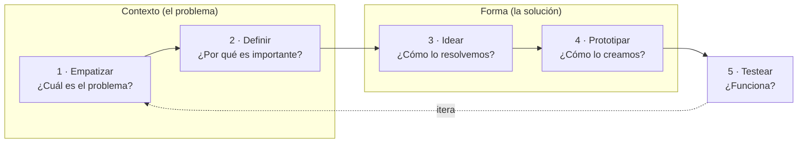
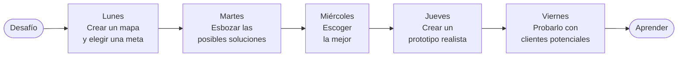
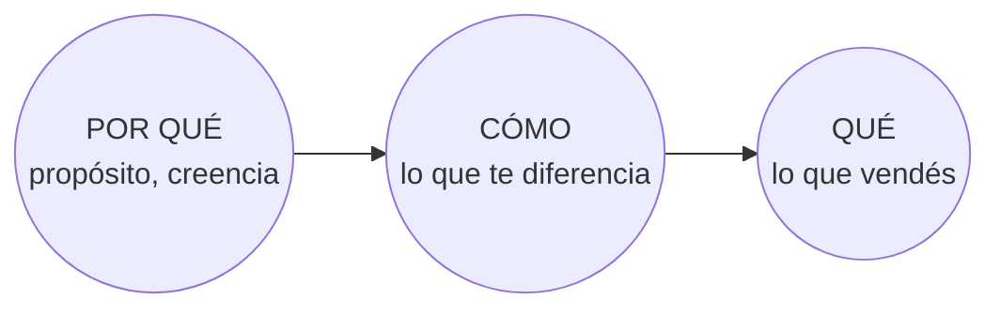

# Apuntes de clase · 18/11

> Notas tomadas en la clase en vivo. Complementan el [resumen de la U2](/modulo-1/unidad-2/README.md) y adelantan temas de la U3 (Design Thinking y Design Sprint).

## ¿Qué es la visión?

La visión de una empresa es una **declaración que describe el futuro deseado y el propósito a largo plazo** de la organización. Es una guía que **inspira y motiva** a los empleados y a otros interesados sobre el rumbo que quiere tomar la empresa.

| Empresa | Visión |
|---|---|
| Apple | "Hacer los mejores productos del mundo y dejar el mundo mejor de lo que lo encontramos." |
| Google | "Organizar la información del mundo y hacerla universalmente accesible y útil." |
| Microsoft | "Brindar mayor poder a la gente a través de un excelente software, en cualquier momento, en cualquier lugar y en cualquier dispositivo." |
| Tesla | "Acelerar la transición del mundo hacia la energía sostenible." |
| Amazon | "Ser la empresa más centrada en el cliente del mundo, donde los clientes pueden encontrar y descubrir cualquier cosa que deseen comprar." |

> Fijate que ninguna habla de **qué** venden: todas hablan de **para qué** existen. Es el "por qué" del Círculo Dorado de Simon Sinek (ver los videos al final de esta página).

Para inspirarse con buenos pitch: [Founders Live](https://www.founderslive.com/).

## Herramientas de Design Thinking

- **Customer Journey Map:** el recorrido del usuario paso a paso, con lo que hace, piensa y siente en cada etapa.
- **Empathy Map:** ver más abajo y en la [U2](/modulo-1/unidad-2/README.md).
- **Design Sprint:** proceso de 5 días para pasar de un desafío a un prototipo probado con usuarios.
- **User Persona:** un usuario arquetípico, basado en investigación, que representa a un segmento.
- **Shadowing:** acompañar y observar al usuario en su contexto real mientras hace la tarea.
- **SCAMPER:** técnica de ideación que propone modificar una idea existente: **S**ustituir, **C**ombinar, **A**daptar, **M**odificar, **P**oner en otro uso, **E**liminar y **R**eordenar.

### Design Thinking: un marco para innovar

| Etapa | Pregunta | Qué se hace |
|---|---|---|
| **Empatizar** | ¿Cuál es el problema? | Definir el desafío y explorar el contexto humano |
| **Definir** | ¿Por qué es importante? | Investigar, observar, entender y armar un punto de vista |
| **Idear** | ¿Cómo lo resolvemos? | Brainstorming de ideas buenas y malas, sin quedarse en lo obvio |
| **Prototipar** | ¿Cómo lo creamos? | Empezar a crear y experimentar: fallar barato y rápido |
| **Testear** | ¿Funciona? | Implementar, mostrar (no contar) y refinar |

> En el gráfico de clase es un **infinito**: las dos primeras etapas son del **contexto** y las dos siguientes de la **forma**, y el testeo vuelve a empezar el ciclo.

### Design Sprint (Google Ventures)

En una semana se pasa de un desafío a aprender con usuarios reales, sin construir el producto. Se ve en detalle en [M1 · U3](/modulo-1/unidad-3/README.md).

## Pretotyping

En **The Right It**, **Alberto Savoia** propone métodos para validar ideas **antes** de invertir fuerte en ellas, para asegurarse de que estás construyendo "lo correcto" (*the right it*). El pretotipo es una versión **más barata y anterior al prototipo**: no pregunta "¿podemos construirlo?" sino "¿lo deberíamos construir?".

| Técnica | Qué se hace | Ejemplo |
|---|---|---|
| **Fake Door** (puerta falsa) | Una página o botón que simula una funcionalidad que todavía no existe. Si hacen clic, hay interés. | Botón "Comprá ahora" que muestra "En desarrollo" |
| **Fake Product** (producto falso) | Ofrecer un producto que no existe para medir el interés | Publicarlo en MercadoLibre o eBay y ver si hay compradores |
| **One-Night Stand** | Ofrecer el servicio por un tiempo muy corto | Alquilar un local un solo día para probar un restaurante |
| **Infiltrator** (infiltrado) | Meter el producto ficticio dentro de un entorno real | Poner un libro falso en una librería y ver si lo compran |
| **Pinocchio** | Una versión física no funcional, para ver cómo reacciona la gente | Un prototipo de cartón de un dispositivo |

> Conecta con lo que vimos en la U2: el caso **Zappos** y la técnica **Mago de Oz** son de la misma familia: aprender con usuarios reales al menor costo posible.

## Jobs to be Done (JTBD)

Pensar **qué es realmente lo que busca el usuario**: la gente no compra productos, los "contrata" para hacer un trabajo.

| La gente no quiere comprar… | Quiere… |
|---|---|
| Un Swiffer (lampazo) | Un piso limpio |
| Una lata de Jolt Cola | Aguantar despierta toda la noche |
| Un Snickers | Un snack a las 4 de la tarde para llegar a la cena |

> El problema de usar el **producto** como unidad de análisis es que te hace competir solo contra productos parecidos. Si mirás el **trabajo**, aparecen competidores inesperados (el Snickers compite con una fruta o con un café, no solo con otras golosinas).

## Entrevistas

- Elegir bien al usuario (el target, no cualquiera).
- Preparar las preguntas con anterioridad.
- Acuerdo de confidencialidad.
- Escucha activa.
- Preguntas abiertas.
- **No preguntar cuál es la solución.**
- ¿Qué tan importante es esto para el usuario?
- ¿Pagaría por este servicio? ¿Hasta cuánto?
- Preguntas de medición: cuánto tiempo invierte, cuánto dinero, etc.

## Empathy Map

**¿Para qué sirve?**

- Conocer profundamente al usuario.
- Descubrir necesidades no expresadas.
- Guiar decisiones de diseño, producto o marketing.
- Alinear al equipo en torno al usuario.

| Sección | Qué va |
|---|---|
| 🧠 **¿Qué piensa y siente?** | Lo que realmente le importa: preocupaciones, aspiraciones e inquietudes |
| 👂 **¿Qué oye?** | Lo que dicen las personas que influyen en sus decisiones |
| 👀 **¿Qué ve?** | Su entorno, sus amigos, el mercado |
| 💬 **¿Qué dice y hace?** | Su actitud en público, su aspecto, su comportamiento hacia los demás |
| 😣 **Esfuerzos** | Puntos de dolor, miedos |
| 🏆 **Resultados** | Beneficios que busca |

---

## Videos comentados en clase

> ⚠️ Desde donde armamos estos apuntes no se pudieron abrir los links de YouTube, así que los resúmenes se basan en las charlas que la clase nombra y en sus ideas conocidas. Si al verlos algo no coincide, corregilo acá.

### 🎥 Simon Sinek · El Círculo Dorado (TED)

[Ver video](https://www.youtube.com/watch?v=7HvYUlH4mkA) · Es su charla TED más conocida, *How Great Leaders Inspire Action* ("Cómo los grandes líderes inspiran la acción"), base de su libro *Start with Why*.

- **La idea:** casi todas las organizaciones comunican de afuera hacia adentro: **qué** hacen, después **cómo**, y casi nunca **por qué**. Las que inspiran (Apple, Martin Luther King, los hermanos Wright) lo hacen al revés: **empiezan por el por qué**.
- **La frase central:** "La gente no compra lo que hacés, compra **por qué** lo hacés."
- **Ejemplo de Apple:** no dice "hacemos buenas computadoras, ¿querés una?", sino "creemos en desafiar el statu quo; lo hacemos con productos bien diseñados y fáciles de usar; y resulta que hacemos computadoras".
- **Por qué funciona:** según Sinek, el "por qué" le habla a la parte del cerebro que maneja las emociones y las decisiones; el "qué" a la parte racional.
- **Ley de difusión de la innovación:** para llegar a la masa primero hay que convencer a los *innovators* y *early adopters* (los primeros ~15%), y a ellos los mueve compartir tu creencia, no las características del producto.

**Para el PM:** la **visión** de producto es el "por qué". Por eso las visiones de Apple, Google o Tesla de la clase no mencionan productos. El programa vuelve sobre este tema en [M2 · U1](/modulo-2/unidad-1/README.md) ("Necesidades y Problemas versus Soluciones: círculo dorado").

### 🎥 Jobs to be Done

[Ver video](https://www.youtube.com/watch?v=Stc0beAxavY) · No pudimos confirmar el título exacto. El marco viene de **Clayton Christensen** (Harvard) y **Bob Moesta**, y la lámina de la clase (Swiffer, Jolt, Snickers) muestra su idea central.

- **La idea:** los clientes no compran productos, los **"contratan" para hacer un trabajo** (*job*) en una situación concreta. Cuando algo lo hace mejor, "despiden" al producto anterior.
- **El caso clásico (el milkshake):** una cadena de comida rápida quería vender más batidos y preguntó a clientes cómo mejorarlos (más espesos, más sabores), sin resultados. Al observar, vieron que muchos se compraban **a la mañana** por gente que manejaba sola al trabajo: el "trabajo" era **hacer entretenido y llevadero el viaje** y aguantar hasta el mediodía. Los competidores reales no eran otros batidos, sino las bananas, las donas o el café.
- **Un job tiene tres dimensiones:** **funcional** (lo práctico), **emocional** (cómo me quiero sentir) y **social** (cómo quiero que me vean).
- **Cómo se usa:** entrevistar sobre la última vez que el cliente "contrató" una solución: qué estaba pasando, qué lo empujó a cambiar y qué lo frenaba.

**Para el PM:** JTBD es una forma de llegar al **problema** antes que a la solución (anti patrón de la U1: "foco en la solución y no en el problema") y de escribir mejores **propuestas de valor** (U2: el valor no es la característica, sino lo que el usuario logra).

---

## Fichas de repaso de esta clase

1. ¿Qué es la visión de una empresa?

Una declaración que describe el futuro deseado y el propósito a largo plazo de la organización. Inspira y motiva sobre el rumbo que quiere tomar.

2. ¿Cuáles son las 5 etapas de Design Thinking?

Empatizar, Definir, Idear, Prototipar y Testear. Las dos primeras trabajan el contexto (el problema) y las siguientes la forma (la solución).

3. ¿Qué se hace cada día de un Design Sprint?

Lunes: mapa y meta. Martes: esbozar soluciones. Miércoles: escoger la mejor. Jueves: prototipo realista. Viernes: probarlo con clientes potenciales.

4. ¿Qué es SCAMPER?

Una técnica de ideación: Sustituir, Combinar, Adaptar, Modificar, Poner en otro uso, Eliminar y Reordenar.

5. ¿Qué diferencia hay entre un pretotipo y un prototipo?

El pretotipo (Alberto Savoia, *The Right It*) es más barato y viene antes: valida si **deberíamos** construir algo. El prototipo valida **cómo** construirlo.

6. Explicá el Fake Door Test.

Un botón o página que simula una funcionalidad que no existe. Si los usuarios hacen clic, se valida el interés (por ejemplo, "Comprá ahora" que muestra "En desarrollo").

7. ¿Qué es el pretotipo Pinocchio?

Una versión física no funcional del producto, como un prototipo de cartón, para ver cómo reacciona la gente.

8. ¿Qué plantea Jobs to be Done?

Que la gente no compra productos sino que los "contrata" para hacer un trabajo. Ejemplo: nadie quiere un Swiffer, quiere un piso limpio.

9. ¿Qué es el Círculo Dorado de Simon Sinek?

Tres círculos: Por qué (propósito), Cómo (diferencial) y Qué (producto). Los que inspiran comunican de adentro hacia afuera, empezando por el por qué.

10. ¿Para qué sirve un Empathy Map?

Para conocer profundamente al usuario, descubrir necesidades no expresadas, guiar decisiones de diseño, producto o marketing, y alinear al equipo en torno al usuario.

