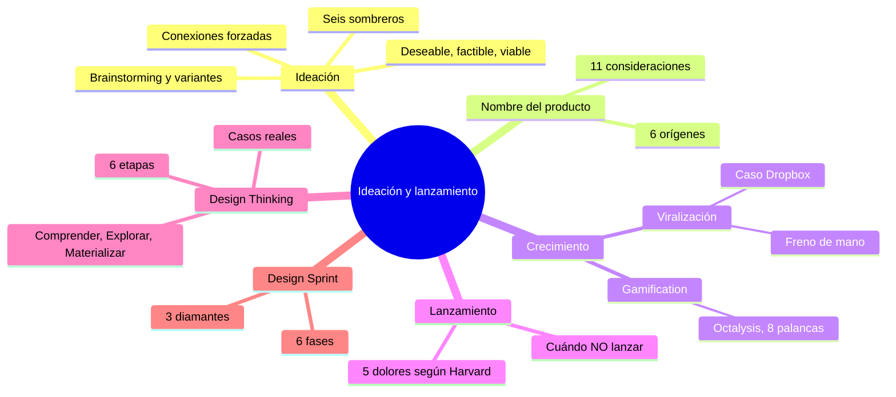
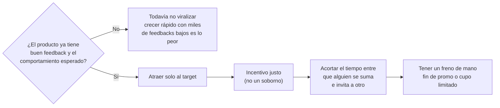
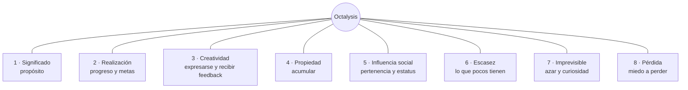
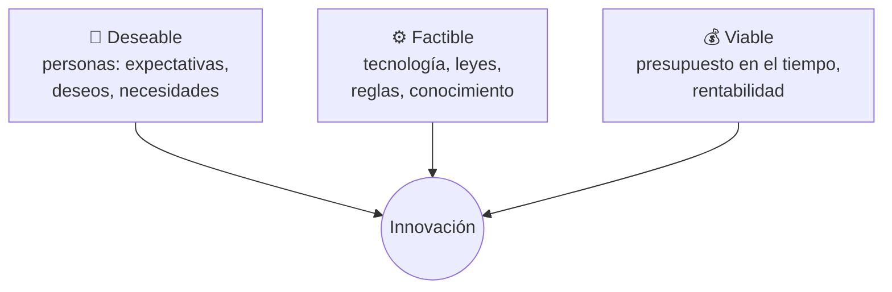
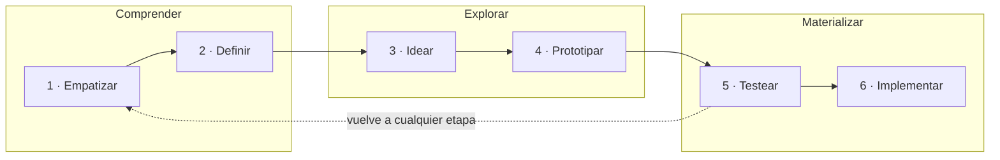
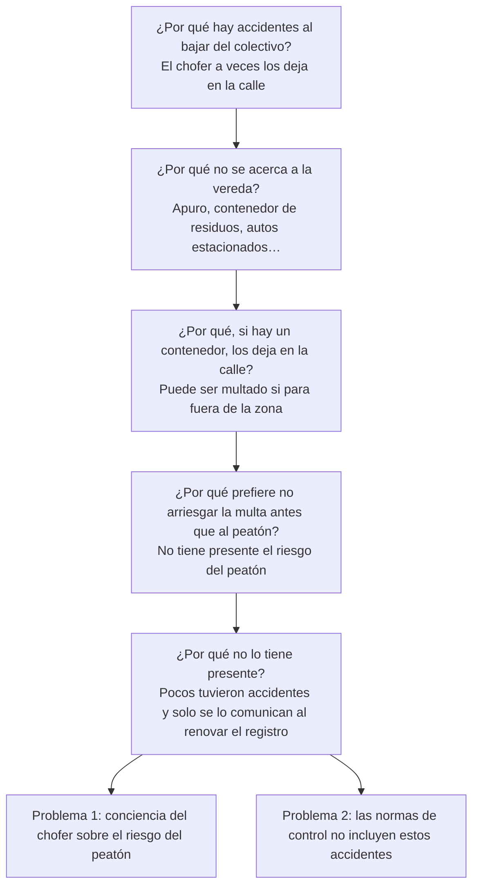
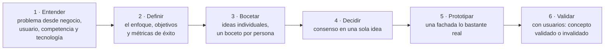
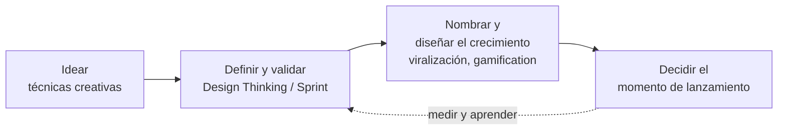

# M1 · U3 — Ideación y Lanzamiento de Productos

> **Módulo 1:** Introducción y Conceptos Fundacionales del Product Management
> Cómo generar ideas de solución, nombrarlas, hacerlas crecer y decidir cuándo salir al mercado. Cierra con Design Thinking y Design Sprint como marcos para pasar del problema a una solución validada.
> 👉 [Fichas de repaso](/modulo-1/unidad-3/fichas.md) · Design Thinking y Design Sprint ya se adelantaron en los [apuntes de la clase del 18/11](/modulo-1/unidad-2/clase-18-11.md)

## Objetivos de la unidad

- Entender cómo crear una solución de producto de valor.
- Conocer técnicas creativas para generar soluciones.
- Resolver las necesidades del usuario generando valor para el negocio.

## Mapa conceptual

> **Nota sobre el temario:** el programa lista también **TAM SAM SOM**, pero el material de esta unidad no lo desarrolla. Queda pendiente por si aparece en clase.

---

## 1. Introducción: evolución del Brainstorming

En el proceso de desarrollo de producto, primero se **empatiza** con los usuarios target (contexto, necesidad, problemas, oportunidades) y después se **exploran soluciones**. Toda solución debe ser:

1. **Deseada** por los usuarios target.
2. **Factible técnicamente:** se puede construir en plazo, con las capacidades y recursos disponibles.
3. **Viable económicamente:** la empresa va a ganar dinero.

El primer paso de la exploración es la **ideación**.

> En Silicon Valley se dice que **una idea no vale nada: lo importante es su ejecución.**

Una idea es innovadora solo si **soluciona el problema del usuario** y **lo hace mejor que las opciones actuales**. Una gran idea con mala ejecución no sirve, y hasta es peor: daña la confianza en la marca y deja que otro la copie y la ejecute mejor.

**Ejemplo:** el iPhone no fue el primer celular con pantalla táctil, pero fue el que mejor la implementó. Nokia tenía una oferta muy inferior por la respuesta lenta del dispositivo.

### Brainstorming: pros y contras

| ✅ Pros | ❌ Contras |
|---|---|
| Trabajo en equipo enfocado en la sinergia | Pensado para lo presencial, no lo virtual |
| Simple, fácil de iniciar | La timidez o el miedo deja afuera a algunos |
| Participación activa de todos | Las jerarquías pueden nublar la actividad |

> El rol de PM toma conocimientos de Marketing, Diseño, Agile y más. **No hace falta ser experto en todo:** sí saber qué herramientas existen, para qué sirven y cuándo profundizar.

### Técnicas de ideación

| Técnica | Cómo funciona | Para qué sirve |
|---|---|---|
| **Brainstorming** | Se presenta un tema; una persona anota y las demás dicen ideas sin que nadie opine. Después se seleccionan. | Clásica y simple. Puede ser confusa en lo virtual. |
| **Brainwriting** | Cada persona, por turno, suma sus ideas por escrito en un papel. | Elimina jerarquías y miedo a participar. |
| **Brainwarming** | Cada idea en un Post-it, escrito individualmente y pegado en una pizarra (mejor de a uno, para que el resto las vea). Ideas en horizontal, variantes en vertical. | Agrupar ideas y construir sobre las de otros. |
| **Time Lapse** | No hacer todas las sesiones creativas el mismo día: dormir entre una y otra. | Problemas muy desafiantes. Es complementaria. |
| **Seis sombreros para pensar** | De **Edward de Bono**. Separa el pensamiento en juicios negativos, juicios optimistas, datos, emociones, creatividad y orden. | Evitar sesgos o visiones únicas. Compleja, pero da muy buenos resultados. |
| **Group Sketching** | Grupos de 2 a 5 personas dibujan la solución. | Simular cómo funcionaría la solución. |
| **Alter Ego** | Ponerse en los zapatos del usuario, desde la necesidad hasta cómo usa la solución. | Empatía con el uso real. |
| **Conexiones forzadas** | Elegir un producto de otra industria, listar sus características y beneficios, y ver si esos beneficios inspiran algo para nuestro producto. | Salir de lo obvio. |

**Solo se mencionan:** Método Cero, SCAMPER (ver [clase 18/11](/modulo-1/unidad-2/clase-18-11.md)), técnica 635, técnica 4x4x4 y Estructuras Liberadoras.

## 2. Nombres de producto

Cada vez que se nombra el producto se transmite un mensaje: **el nombre es el mensaje que más se repite**.

### De dónde puede salir un nombre

| Origen | Ejemplos |
|---|---|
| Nombre del fundador o inspirador | Hewlett-Packard, Louis Vuitton, Tesla |
| Describe el servicio | Southwest Airlines, Universal Assistance |
| Palabra relacionada con la industria o la marca | iPhone, iOS, Android |
| Describe la experiencia o imagen a lograr | Sprint, Flecha Bus, Ualá |
| Concepto ajeno a la industria | Apple, Mango, Vitamina |
| Palabra inventada | Google |

### 11 consideraciones para elegirlo

1. **Causa impacto:** distintivo, inusual, que sorprenda y se recuerde. Que no se parezca a otro popular.
2. **Breve y conciso:** WhatsApp, Facebook, Adidas. Los difíciles se olvidan.
3. **Fácil de escribir y pronunciar** para *tus* usuarios y clientes.
4. **Cómo suena:** hay sonidos que dan gusto decir (a los hispanohablantes suelen gustarnos el portugués o el francés).
5. **Mensaje que transmite:** ligado a los anhelos del usuario target.
6. **Fácil de recordar** justo cuando se necesita. El máximo: que el nombre pase a nombrar la categoría (**Birome**, **Post-it**, **Savora**).
7. **Innovación:** algo nuevo o en línea con las tendencias del momento.
8. **Posibilidad de acrónimos.**
9. **Referencias de otros idiomas:** cuidar qué significa la palabra para quienes hablan ese idioma.
10. **Familia de nombre:** traslada la confianza de la marca al producto nuevo (iPad, iPod, iPhone, iWatch: una sola "i").
11. **Análisis de popularidad** con **Google Trends**.

Como cierre, testear el nombre con posibles usuarios.

> **No hay nombre genial si así no lo perciben sus usuarios target.**

## 3. Viralización de productos

Hay **viralización** cuando un producto se adquiere por la recomendación o acción de un usuario actual. Si el ciclo continúa, crece en **curva exponencial**. La unidad recomienda el documental *El dilema de las redes sociales* (Netflix) para entender el marketing basado en datos.

### Caso Dropbox

- Por cada persona referida que usaba la app, regalaba **100 MB** extra. Como el plan básico tenía solo 100 MB, referir permitía tener **10 veces más** espacio: un empuje fuerte.
- Puso un **límite de referidos**: analizaron cuántas personas recomienda alguien promedio y vieron que sin tope algunos crearían cuentas fantasma. Otras empresas sin límite tuvieron abusos, costos y usuarios falsos.
- Dejó una **brecha amplia** entre el mejor plan gratis y el pago (el pago es 20 veces mejor) para que no compitan entre sí.

### Qué tener en cuenta

- **Muchas acciones no tienen vuelta atrás:** muchos usuarios generan costo de mantenimiento, y si no son los deseados o son más de los que se puede atender, es un gran problema.
- **Usuarios no target** pueden subir costos y desvalorizar el producto.
- **Calidad primero:** si el producto todavía no tiene buen feedback, no es momento de viralizar.
- **Nació en lo físico:** 50% en la peluquería si venís con una amiga, el cumpleañero no paga si viene con 4 amigos.
- **Incentivo excesivo = soborno:** ¿qué pasa cuando el extra desaparece? ¿Le interesa el producto?
- El **feedback cambia** con el crecimiento (cae la calidad o entran personas con otras opiniones).
- **Costos y precios:** la masividad puede bajar costos, o se puede bajar el precio para viralizar más rápido.
- **Error típico:** darle más beneficios al referido que al usuario actual. Corta (o nunca inicia) el ciclo.
- **Cuanto más corto el tiempo** entre que alguien se vuelve usuario e invita a otro, más rápida la viralización (un meme: rápido de ver, rápido de compartir).
- **Freno de mano:** fin de promoción o cupo limitado desde el inicio. Si funciona, se extiende.

## 4. Gamification

Llevar el atractivo de los juegos a los productos para **fidelizar**, **atraer clientes** y mantener a la gente **enganchada**. La unidad presenta el marco **Octalysis de Yu-kai Chou**: **8 palancas** (drivers) que inspiran ideas. No hace falta usarlas todas: se elige según lo que se necesite.

| Palanca | Qué moviliza | Ejemplos de la unidad |
|---|---|---|
| **1 · Significado** | Un propósito interno: ecología, bien común, tener lo último en tecnología | Wikipedia (colaboradores gratuitos), Cabify (reduce el efecto contaminante de cada viaje). Contraejemplo: críticas a Bitcoin por su consumo de energía |
| **2 · Realización** | Sentir que progresamos y cumplimos metas | Niveles y puntos de Mercado Libre; puntos de Banco Galicia canjeables por viajes |
| **3 · Creatividad** | Expresarse y ser reconocido | Muros y "me gusta" de Facebook; el usuario genera su propio contenido |
| **4 · Propiedad** | Obtener y acumular, aunque no dé un beneficio real | Puntos de Mercado Libre, millas de aerolíneas |
| **5 · Influencia social** | Pertenecer, identificarse, estatus | "Me gusta", rankings, categoría Éminent de Galicia, embarque prioritario, pases de Disney |
| **6 · Escasez** | Querer lo que pocos tienen | Ediciones limitadas, vidas limitadas en Candy Crush, figuritas difíciles del álbum |
| **7 · Imprevisible** | El placer del azar y la curiosidad | Sorteos, trivias que suman o restan puntos. Ojo: los juegos por dinero o puntos están regulados en muchos países |
| **8 · Pérdida** | Miedo a perder algo o perderse una promo | **Rachas** de Duolingo: si no lo usás un día, vuelve a cero |

**Puntos de atención:**

- **Motivadores extrínsecos:** los de Realización (puntos, viajes) no tienen que ver con la necesidad real. Hay clientes que siguen en un banco con mala experiencia solo porque están cerca de un pasaje. Ayuda, pero **una mala experiencia tarde o temprano espanta al usuario**.
- **Ética:** Creatividad e Influencia social pueden generar adicción (pendientes de los "me gusta"). Hay apps que se desactivan al manejar porque sus usuarios las usaban conduciendo.
- **Ejercicio propuesto:** identificar qué palancas usan Duolingo, Candy Crush, Forest e Instagram.

> **La gamificación es un gran diferencial, pero no suplanta los beneficios y la experiencia del producto en el largo plazo.**

## 5. Momento de lanzamiento

¿Cuándo lanzar? Aplica a productos nuevos y a funcionalidades nuevas de un producto existente.

### Cuándo NO lanzar

| ❌ No lanzar… | Por qué |
|---|---|
| **Con calidad incorrecta** | Las hipótesis principales no funcionan bien. Pasa por priorizar fechas "como sea". |
| **Con todas las funcionalidades desarrolladas** | Si hay incertidumbre sobre cómo reaccionarán los usuarios, construir todo es caro, lento y sin certezas. |
| **Llegando directo a todos los usuarios** | Un error masivo no es aprendizaje, es tragedia. Hacer **salidas escalonadas** por grupos y pedir feedback entre cada una. |
| **Sin acordar la fecha con los interesados** | Puede romper otros productos internos o externos y dar malas experiencias. |
| **Sin saber qué ni cómo medir** | El trabajo termina cuando se cumplen los objetivos comerciales: ¿lo usan? ¿Cuánto? ¿Qué valor aporta? ¿Cuántos reclamos? ¿Satisfacción? |
| **Sin saber tratar los reclamos** | Si los canales propios fallan, el cliente se queja en redes (caso de una empresa de salud que respondió tarde en Facebook). |
| **Sin proceso de vuelta atrás** | A veces hay que retirar o volver a la versión anterior. Casos: antena del iPhone, baterías de Samsung, vulneración de seguridad en Mercado Pago. |
| **Sin marketing ni comunicación** | Generar una "sana ansiedad" para que el usuario llegue con ganas de comprar (películas, autos). |
| **Sin mirar el momento de la empresa o del año** | Evitar picos de actividad, cierres contables o fiestas populares. |

> El PM **no es experto** en todos estos puntos, pero debe conocerlos, priorizarlos y **tomar la decisión** de lanzar o no lanzar.

### Los 5 dolores de un lanzamiento (según investigaciones de Harvard)

1. **No puede escalar tan rápido:** crecen los usuarios y la plataforma no aguanta (un login financiero con tiempo de espera hasta que otros salieran).
2. **No cumple sus beneficios básicos:** un celular lindo y chico, pero con mala recepción.
3. **No se validó que cubra las necesidades:** el más común en software, productos llenos de features que nadie sabe si se usan.
4. **Es muy complicado:** los usuarios no entienden cómo usarlo y lo abandonan (de una app a una carpa).
5. **Es revolucionario, pero no hay mercado:** realidad virtual en los 90, TV 3D en los 2000, realidad aumentada en 2015. No hay que salir ni tarde ni temprano, sino **en el momento justo**.

> **El error más común y duro:** no tener un proceso preparado para empatizar con el usuario, y no pensar que las soluciones son **hipótesis** que pueden ser válidas o inválidas. Trabajar con certezas "como Steve Jobs" y después decir que "los usuarios no están a la altura del producto".

## 6. Design Thinking

Marco de trabajo para definir un producto, un servicio o una innovación sobre ellos. Lo usan mucho las **FAANG** (Facebook, Amazon, Apple, Netflix, Google).

> "Su objetivo es solucionar problemas enfocándose en las necesidades de las **personas**, trabajando en **equipos multidisciplinarios**, pensando soluciones **deseables**, tecnológicamente **factibles** y económicamente **viables**."

> "La vida es demasiado corta para construir algo que nadie quiere." (Ash Maurya)

**Desafío de la billetera:** la unidad arranca pidiendo diseñar una billetera en 3 minutos. Al final pregunta: ¿para qué usuarios la pensaste? ¿Cuál era su necesidad? ¿Era deseable, factible y viable? (La trampa: casi todos dibujamos sin pensar primero para quién.)

**Ejemplo de la teletransportación:** el cliente pide una máquina para teletransportarse al trabajo. Indagando, la necesidad real es que tarda dos horas y **se aburre en el viaje**. Con eso aparecen soluciones simples: leer, ver una película, o trabajar remoto y evitar el viaje.

### Los 3 pilares de la innovación

- **Deseable:** el primer error no es ignorar qué desea el usuario, sino **no enfocarse en un grupo específico** de usuarios.
- **Factible:** elegimos primero soluciones dificilísimas sin conocimiento, tiempo ni recursos.
- **Viable:** ¿la podemos pagar? ¿Es rentable? ¿Entendemos cómo ganar dinero?

### Las 6 etapas, en 3 momentos

| Momento | Pregunta | Etapas |
|---|---|---|
| **Comprender** | ¿Cómo centrarse en las personas para entender su necesidad y su entorno? | **Empatizar** (ponerse en el lugar del otro) y **Definir** (entender la necesidad y acotar el problema) |
| **Explorar** | Con lo aprendido, ¿cómo generamos ideas y un prototipo? | **Idear** (pensar soluciones y elegir una) y **Prototipar** (diseñar o construir) |
| **Materializar** | ¿Cómo pruebo si funciona y cómo llega al cliente? | **Testear** (¿satisface la necesidad?) e **Implementar** (llevar al cliente un producto ya testeado) |

> **Diferencia con la clase del 18/11:** en clase vimos 5 etapas (sin Implementar). La unidad suma **Implementar** y aclara que algunos libros la dejan afuera porque puede ser un proyecto en sí mismo.

### 1 · Empatizar (divergencia)

Herramientas, solas o combinadas:

- **Observar:** el lugar donde la persona tiene la necesidad, qué abunda, qué falta, cómo se siente. O ponerse en sus zapatos (pasar 1 o 2 días con enfermeros en una clínica).
- **Protopersonas:** estereotipos de quienes usarían el producto: qué piensan, sienten, dicen, hacen, cómo es su entorno. Afines: **Personas** y **Mapa de Empatía**. El segmento se elige por **poder adquisitivo** y por **si podemos resolver su necesidad**.
- **Entrevistas individuales:** ⭐ **la herramienta más importante para empatizar.** Definir a quién, preparar preguntas abiertas o semiabiertas (evitar cerradas), pedir permiso para grabar. Después de **9 entrevistas** los datos empiezan a repetirse: momento de parar. Son **cualitativas**.
- **Entrevistas grupales:** ahorran tiempo, pero la primera respuesta condiciona al resto y hay menos intimidad.
- **Encuestas:** llegada masiva, rápida y económica, sin repregunta. Para **cuantificar**, siempre **después** de las entrevistas.
- **User Journey:** línea de tiempo de cómo vive el cliente su situación actual (alta, uso, reclamos, baja), con el impacto de cada evento: positivo, neutro o negativo.

Termina con el problema **expandido**: aparecen problemas nuevos. Por eso es una etapa de **divergencia**.

**Ejemplo:** "Disminuir accidentes de tránsito con peatones" se abre en: cruzar avenidas, subir y bajar del colectivo, choques con ciclistas, chicos que salen de la escuela.

### 2 · Definir (convergencia)

> "Si no se entiende el problema, no tiene sentido hablar de soluciones."

Se agrupan los problemas (por tipo de usuario, contexto, temática, journey) y se elige uno con el criterio de **dónde se puede aportar más valor**.

**Técnicas de decisión en equipo:**

| Técnica | Regla |
|---|---|
| **Consenso** | Todos de acuerdo |
| **Consentimiento** | Nadie en contra |
| **Votación** | Lo que elige la mayoría |
| **Responsable elige** | Decide una persona |

Para no quedarse en el **síntoma** y llegar a la **causa raíz**: **5 Porqués** o **Espina de pescado** (Ishikawa). Ver también [LSS · Herramientas](/lean-six-sigma/herramientas.md).

**Ejemplo de 5 Porqués (peatón que baja del colectivo):**

En el segundo nivel el árbol se **abre en paralelo** (varias causas): hay que elegir una rama según **capacidad de acción** y esfuerzo.

### 3 · Idear (convergencia y divergencia)

Converge al elegir un problema y diverge al generar **muchísimas** soluciones. La herramienta más popular es el **Brainstorming**; se pueden sumar especialistas (tecnología, derecho, diseño) y clientes representativos.

**Ejemplo** para "las normas no incluyen los accidentes al bajar del colectivo": sanción por quejas telefónicas, web de reclamos, carteles en el colectivo, premio mensual según reclamos, comunicar suspensiones, **sensor que cuente cuántas veces abrió la puerta lejos del cordón**… cientos más.

Se elige una para prototipar descartando lo no factible, no viable o no deseable, con las mismas técnicas de decisión.

### 4 · Prototipar

Un prototipo es **lo mínimo que se puede construir para probar si la idea es válida o inválida**. No es el producto final: puede cambiar todo menos lo necesario para validar la hipótesis.

- Ejemplo: si la hipótesis es un celular de **2x2x2 cm**, alcanza con una cajita de ese tamaño para probar cómo se maneja y se guarda.
- **Smartwatch:** un celular con velcro atrás, limitado a mostrar notificaciones.
- Sirve para descubrir diferencias de pensamiento en el equipo, abre preguntas que cuestionan etapas anteriores y ayuda a **vender** la idea.
- Objetivos posibles: **pensar, mostrar o descubrir**. De eso depende si es un dibujo, un plano, una maqueta o un producto con menos detalle.

### 5 · Testear

- Escribir **casos de prueba** (situación y resultado esperado). Muchas veces ya eso cambia el prototipo.
- Estar atentos a lo inesperado: es una etapa de mucha recolección de información.
- **Cuantos más usuarios lo prueben, más hipótesis se validan y menor riesgo.**
- Analizar el feedback, mejorar y volver a testear.

### 6 · Implementar

Se diseñan las especificaciones reales y se entrega al cliente. Puede ser un proyecto en sí mismo, más grande que todo lo anterior. Combina bien con **Lean Startup**.

> Las etapas no son estrictamente lineales: **volver atrás no es un fracaso**, es aprendizaje rápido y barato comparado con entregar algo que no sirve.

### Casos reales

| Caso | Problema inicial | Problema detallado | Solución |
|---|---|---|---|
| **Disney World** (EE.UU.) | La gente se queja de la espera | Se aburre y se cansa en las colas | Entretenimiento en la fila: la diversión empieza en la cola |
| **Starbucks Banco Galicia** (Argentina, 2017) | A la gente no le gusta ir al banco | Esperar sin poder usar el celular ni hacer otra cosa (foco: 20 a 55 años) | Sucursal dentro de un Starbucks: café, música, celular y sentados |
| **Resonador del Hospital Garrahan** (Argentina) | Los chicos se mueven y el estudio falla | Miedo desde que les avisan: bata, aparato, camilla fría, oscuridad, ruidos | Causa raíz: el **miedo**. "La Aventura Espacial": desafíos previos, bata espacial, nave con planetas. Los chicos quieren volver a entrar |

## 7. Design Sprint de Google

Modelo basado en **Design Thinking** y **Agile** para ir de entender al usuario a una solución probada **en una semana** (5 días seguidos, el equipo deja el trabajo diario). ¿Para qué construir durante meses para probar un concepto?

> "Design Sprint es una metodología probada para resolver problemas mediante el diseño, la creación de prototipos y la prueba de ideas con los usuarios. […] Es una herramienta para desarrollar una hipótesis, crear un prototipo de una idea y probarla rápidamente con la menor inversión posible en un entorno lo más real posible." (Google)

**La contra:** se usa en el momento incorrecto, o se hacen actividades con pocos datos solo para cumplir los tiempos. Funciona muy bien si hay **buenos datos previos** (Google tiene casi todos los datos de las personas).

**3 diamantes:** la primera mitad de cada diamante es **divergencia** (generar más datos) y la segunda, **convergencia** (seleccionar).

| Fase | Qué se hace |
|---|---|
| **1 · Entender** (Understand) | Expertos articulan el problema desde negocio, usuario, competencia y tecnología. |
| **2 · Definir** (Define) | Con lo aprendido se elige **"el enfoque"**: contexto, resultados deseados, objetivos y métricas de éxito. |
| **3 · Bocetar** (Sketch) | Ideas individuales que se reducen a un boceto bien articulado por persona. Está bien tomar lo bueno de otros. |
| **4 · Decidir** (Decide) | Cada uno comparte su boceto y el equipo llega a consenso en **una sola idea**. |
| **5 · Prototipar** (Prototype) | Una **fachada** suficientemente real para obtener respuestas auténticas. Sin back-end completo ni todos los flujos. |
| **6 · Validar** (Validate) | Probar con usuarios (y si aplica, viabilidad técnica y stakeholders). Validado o invalidado: igual se aprendió rápido y barato. |

> **Diferencia con la clase del 18/11:** en clase vimos la versión de **Google Ventures** por días (lunes: mapa y meta; martes: esbozar; miércoles: escoger; jueves: prototipo; viernes: probar). La unidad usa las **6 fases** del sitio DesignSprint.Google. Son dos formas de contar el mismo proceso.

> "Tener una herramienta o técnica sin entender su propósito o cómo se usa es como tener un martillo y usar su mango para amasar… puede traer más complicaciones que beneficios."

**Para profundizar:** el sitio DesignSprint.Google y el libro *Sprint* de **Jake Knapp** y **John Zeratsky** (Google Ventures), con el proceso día por día.

## 8. Conclusiones

> **Design Thinking es un marco base para el desarrollo de producto.** Design Sprint está muy de moda y es útil, pero es mucho más útil para quienes ya saben Design Thinking.

---

## Autores y referentes citados

| Persona o fuente | Por qué aparece |
|---|---|
| Edward de Bono | Seis sombreros para pensar |
| Yu-kai Chou | Marco de gamificación Octalysis (8 palancas) |
| Ash Maurya | "La vida es demasiado corta para construir algo que nadie quiere" |
| Jake Knapp y John Zeratsky | Libro *Sprint* (Google Ventures) |
| DesignSprint.Google | Definición y 6 fases del Design Sprint |
| *El dilema de las redes sociales* (Netflix) | Documental recomendado sobre marketing basado en datos |
| Dropbox | Caso de viralización con límite de referidos |
| Duolingo, Mercado Libre, Banco Galicia, Candy Crush | Ejemplos de palancas de gamificación |
| Disney World, Starbucks Banco Galicia, Hospital Garrahan | Casos reales de Design Thinking |

## Preguntas de repaso

1. ¿Qué tres condiciones tiene que cumplir una solución?
2. ¿Por qué se dice que "una idea no vale nada"?
3. ¿Qué diferencia hay entre Brainstorming, Brainwriting y Brainwarming?
4. ¿En qué consisten los Seis sombreros para pensar y las Conexiones forzadas?
5. Nombrá cinco consideraciones para elegir el nombre de un producto.
6. ¿Qué hizo bien Dropbox con su estrategia de referidos?
7. ¿Cuándo no conviene viralizar un producto?
8. ¿Cuáles son las 8 palancas de Octalysis? Dá un ejemplo de cada una.
9. ¿Por qué la gamificación no alcanza por sí sola para fidelizar?
10. Nombrá cinco situaciones en las que no conviene lanzar.
11. ¿Cuáles son los 5 dolores de un lanzamiento según Harvard?
12. ¿Cuáles son las 6 etapas de Design Thinking y en qué tres momentos se agrupan?
13. ¿Cuál es la herramienta más importante para empatizar y cuándo se deja de entrevistar?
14. ¿Qué etapas son de divergencia y cuáles de convergencia?
15. ¿Cuáles son las 6 fases del Design Sprint de Google?

Respuestas en las [fichas de repaso](/modulo-1/unidad-3/fichas.md).
