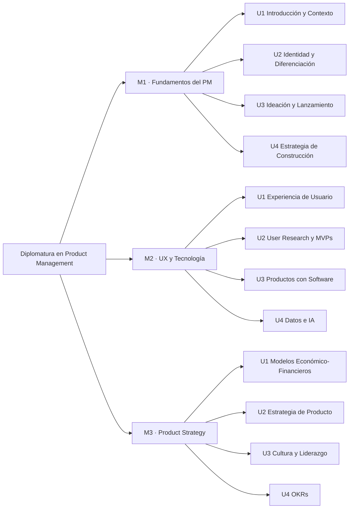

# Programa de la Diplomatura

**Diplomatura en Product Management** · Centro de e-Learning SCEU, UTN-BA
**Duración:** 12 semanas · **Carga horaria:** 90 horas · **Certificación:** UTN

## Objetivo general

Desarrollar las habilidades para convertirse en Gerente de Producto Senior.

## Objetivos específicos

- Entender la diversidad de prácticas, marcos de trabajo y herramientas para crear y desarrollar un producto: desde UX, pasando por desarrollo, hasta el Product Management propiamente dicho.
- Formarse como Product Managers o Gerentes de Producto.
- Comprender los fundamentos para idear y desarrollar funcionalidades de forma adaptativa e iterativa.
- Comprender y dominar los principales exponentes ágiles: Scrum, Lean y Kanban.

## Cómo se aprueba

- Leer y ver todos los contenidos.
- Entregar y aprobar todas las actividades obligatorias, **dentro de la duración del trayecto** (después no se aceptan entregas).
- Aprobar la **Evaluación Integradora Final** (trabajo práctico o multiple choice).
- Cumplido todo: Certificado de Aprobación. Si es parcial: Certificado de Participación.

Hay clase en vivo por Zoom como mínimo cada 15 días, y consultas al tutor por foros y mensajería del campus.

## Mapa del programa

## Temario completo

### Módulo 1 · Introducción y Conceptos Fundacionales del Product Management

- [U1 · Introducción y Contexto](/modulo-1/unidad-1/README.md): Time to Market, origen del PM, era del Software, cocreación de valor, qué es un producto, ciclo de vida, PMF, productos digitales, Manifiesto Ágil, esencias y valores ágiles, mentalidad ágil, anti patrones, PRD.
- [U2 · Identidad y Diferenciación de Productos](/modulo-1/unidad-2/README.md): visión, propuesta de valor, mercado objetivo, el producto en la empresa, técnicas de validación, Feedback Grids, Empathy Maps, Assumption Grids, Product Canvas, Lean UX Canvas.
- [U3 · Ideación y Lanzamiento de Productos](/modulo-1/unidad-3/README.md): brainstorming, nombres de producto, viralización, gamification, momentos de lanzamiento, TAM SAM SOM, Design Thinking, Design Sprint de Google.
- [U4 · Estrategia de Construcción del Producto](/modulo-1/unidad-4/README.md): backlog, roadmap, Planning Onion, Business Canvas, historias de usuario, Story Mapping, Flow Framework, planificación ágil de releases.

### Módulo 2 · User Experience y Tecnologías en la era del Software

- [U1 · Experiencia de Usuario](/modulo-2/unidad-1/README.md): empatía, clientes vs usuarios, personas y segmentación, user journeys, genoma de contenido, círculo dorado, desarrollo guiado por hipótesis, usabilidad, accesibilidad, idioma del producto.
- [U2 · User Research y MVPs](/modulo-2/unidad-2/README.md): necesidades vs requerimientos, Kano, MoSCoW, Pareto, observación, funnel de ventas, MVP y MVF, Lean Startup, Lean UX, A/B testing, canary release, concierge, mystery shopper, feature stub.
- [U3 · Productos con Desarrollo de Software](/modulo-2/unidad-3/README.md): ciclo de vida del software, metodologías y principios ágiles, deuda técnica, cloud y contenedores, guardias y soporte, lenguajes de programación.
- [U4 · Datos e Inteligencia Artificial](/modulo-2/unidad-4/README.md): valor de los datos, métricas (MAU, NPS, CAC, ARPU, CPM, CTR), big data, inferencia estadística, machine learning.

### Módulo 3 · Product Strategy

- [U1 · Modelos Económico-Financieros](/modulo-3/unidad-1/README.md): eficiencia ágil, inversión ágil, valor de negocio, VAN, ROI, TIR, Beyond Budgeting, WSJF, IaaS/PaaS/SaaS, e-commerce, ecosistemas digitales, freemium.
- [U2 · Estrategia de Producto](/modulo-3/unidad-2/README.md): dimensionamiento de mercado, FODA, análisis competitivo, Blue Ocean, KPIs vs OKRs, indicadores adelantados y rezagados, contratos ágiles, AARRR, HEART.
- [U3 · Cultura, Liderazgo e Interacciones](/modulo-3/unidad-3/README.md): Tuckman, cultura de aprendizaje, ADKAR, niveles de conciencia, el PM como comunicador, motivación.
- [U4 · OKRs para Product Management](/modulo-3/unidad-4/README.md): origen, fórmula de Doerr, cadencia, check-ins, acciones vs KRs, seguimiento, cambio cultural, OKRs de producto.

## Equipo docente (según el programa)

Ulises Martins, Ignacio Madrid, Gonzalo Suarez del Cerro, Maite Iglesias, Laura Ricchio, María Laura Tripaldi, Hernán Ricchio, Giuliana Vazquez, Mariela Perez, Stefania Isi, Johanna Palmeira, Facundo Baigorria y Sebastián Curcio.
